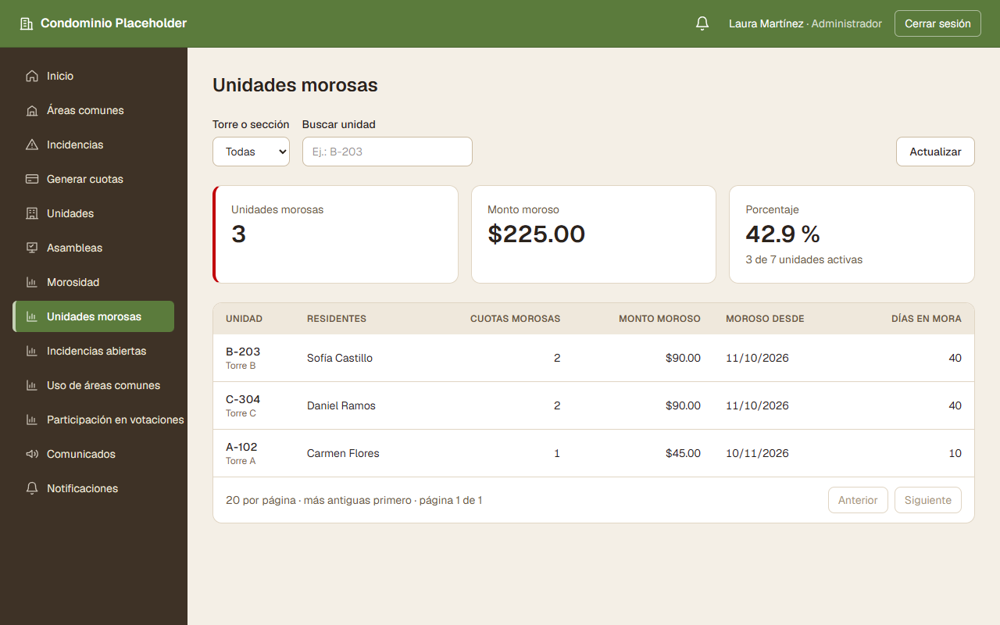
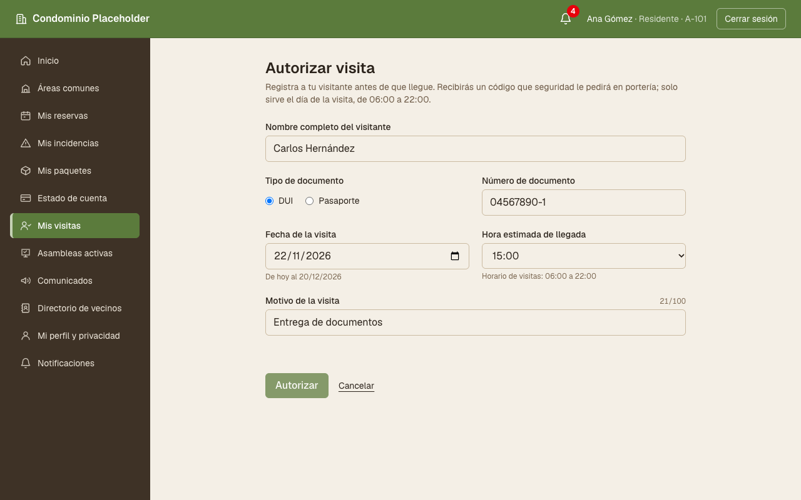
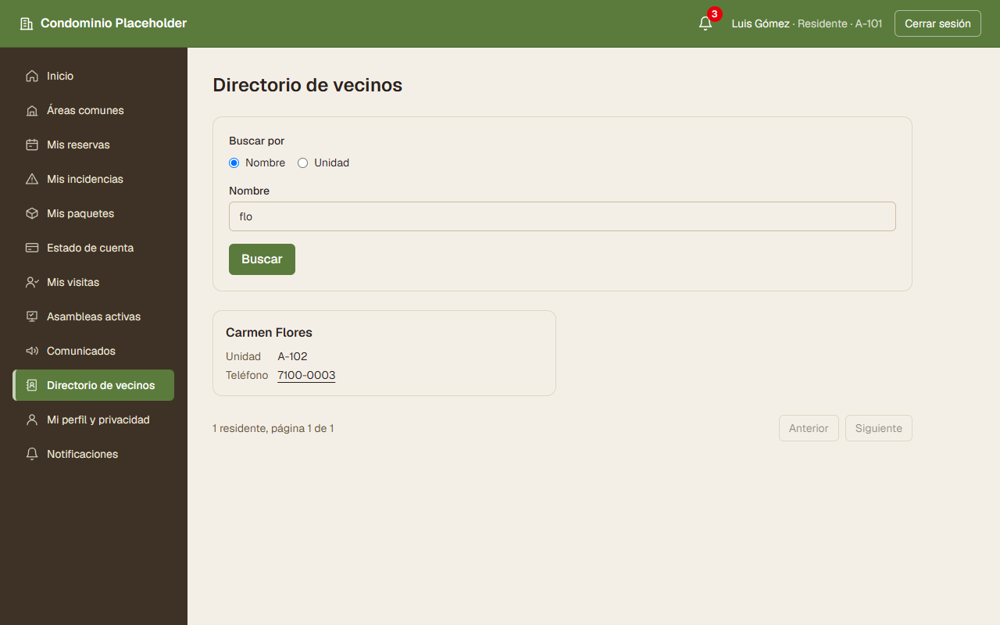
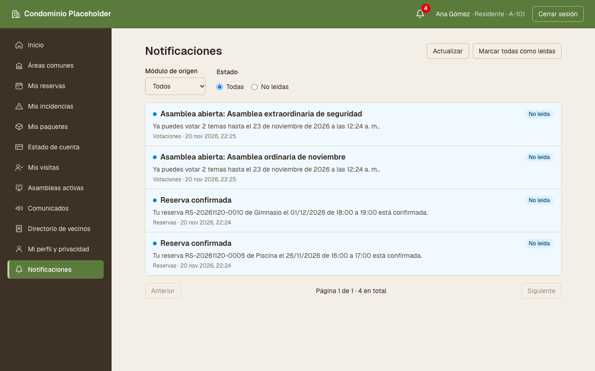
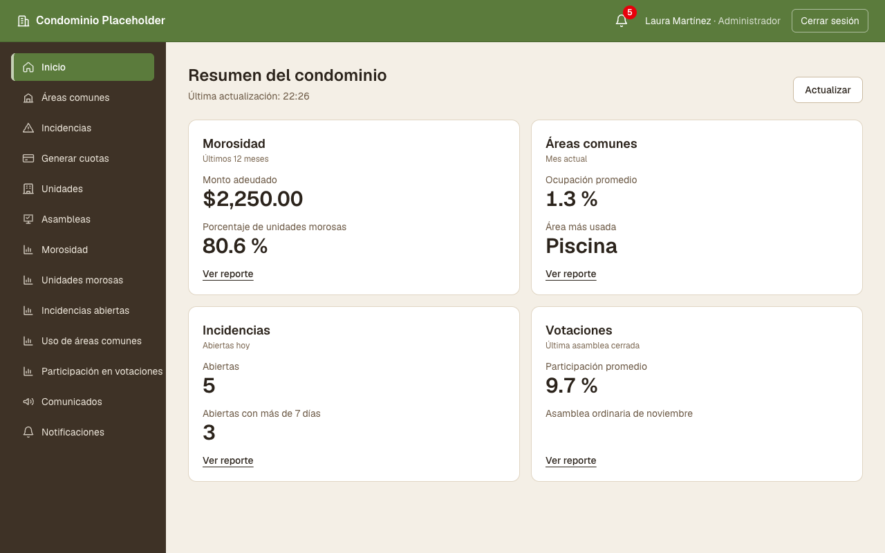
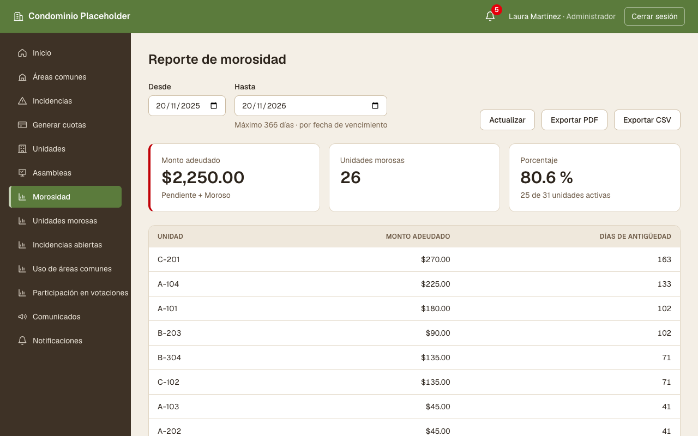
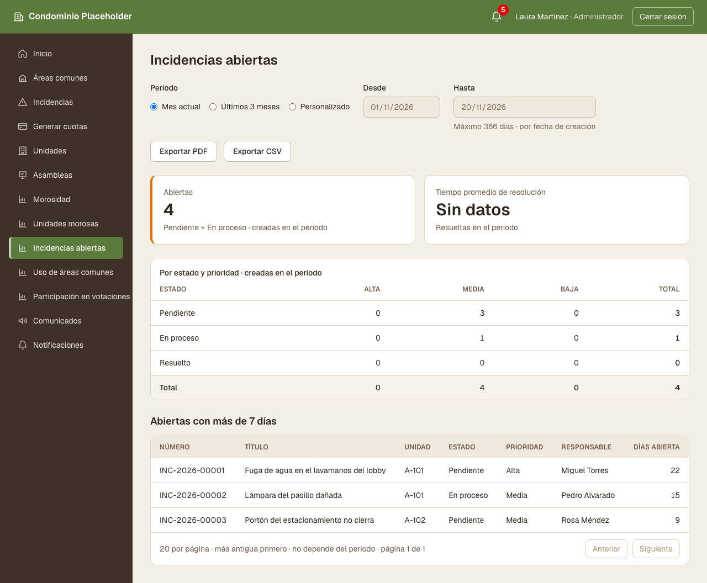

<!-- Cada responsable agrega aquí los flujos de sus módulos, con capturas en docs/img/. Borrar este comentario antes de entregar. -->

# Guía de uso

## Roles

| Rol | Qué puede hacer |
|---|---|
| Administrador | Configura áreas comunes, genera cuotas, gestiona incidencias, convoca asambleas, publica comunicados y consulta los reportes. |
| Residente | Paga sus cuotas, reserva áreas comunes, reporta incidencias, autoriza visitas, recibe paquetes, vota en asambleas, lee comunicados y busca vecinos en el directorio. |
| Personal de seguridad | Registra la entrada y salida de visitantes, consulta quién está dentro y registra la llegada y entrega de paquetes. |

Cada rol ve en el menú lateral solo sus opciones. Si alguien abre la ruta de otro rol, la pantalla muestra "No tienes permiso para ver esta página." y el backend responde 403.

## Flujos principales

### Módulo 1: Cuotas y pagos

<!-- H1 y H2 (pago de cuotas y estado de cuenta): Carlos. -->

#### Generar las cuotas del mes (Administrador)

1. Abrir "Generar cuotas" en el menú.
2. Elegir el periodo: el mes actual o uno de los tres siguientes.
3. Escribir el monto por unidad (entre $1.00 y $5,000.00). La fecha de vencimiento propone el día 10 del periodo y el concepto se llena solo, pero los dos se pueden cambiar.
4. Presionar "Generar". El sistema indica cuántas unidades activas recibirán la cuota y pide confirmar.
5. Al confirmar, muestra cuántas cuotas se crearon y cuántas se omitieron porque la unidad ya tenía cuota de ese periodo. La generación queda en el historial de la derecha.

#### Consultar las unidades morosas (Administrador)

1. Abrir "Unidades morosas" en el menú.
2. Las tarjetas muestran cuántas unidades están morosas, el monto moroso total y el porcentaje sobre las unidades activas.
3. La tabla lista cada unidad con sus residentes, la cantidad de cuotas en mora, el monto, la fecha desde la que está morosa y los días en mora, de la más antigua a la más reciente.
4. Para acotar la lista, elegir una torre o escribir parte del código de la unidad. La búsqueda se aplica al dejar de escribir o al presionar Enter.
5. Al hacer clic en una fila se abre el estado de cuenta de esa unidad en solo lectura.

"Morosidad", en el mismo menú, es otro reporte (H32): resume lo adeudado en un rango de fechas de vencimiento.

#### Recordatorios y paso a Moroso (automático)

El backend corre dos tareas todos los días, en hora de El Salvador:

- **00:05:** las cuotas Pendiente que vencieron hace más de 30 días pasan a Moroso, y los residentes de la unidad reciben la notificación "Cuota en mora".
- **08:00:** las cuotas Pendiente que vencen en 5 días o menos generan la notificación "Cuota por vencer", una sola vez por cuota.

Las notificaciones aparecen en la campana y en "Notificaciones" del residente, y las cuotas morosas se reflejan en el estado de cuenta y en "Unidades morosas". Para correr las dos tareas sin esperar el horario, el administrador puede usar `POST /api/v1/cuotas/tareas/ejecutar` desde Swagger. Repetirla no duplica cambios ni notificaciones.

### Módulo 4: Control de acceso de visitas

#### Preautorizar una visita (Residente)

1. Abrir "Mis visitas" y presionar "Autorizar visita".
2. Escribir el nombre completo del visitante y elegir el tipo de documento (DUI o Pasaporte) con su número.
3. Elegir la fecha de la visita (de hoy a 30 días) y la hora estimada de llegada, entre las 06:00 y las 22:00 en pasos de 15 minutos.
4. Escribir el motivo de la visita y presionar "Autorizar".
5. El sistema muestra el código de 6 caracteres, el visitante, la fecha y la vigencia. El código solo sirve el día de la visita, de 06:00 a 22:00. "Copiar código" lo copia para compartirlo con el visitante, que lo presenta en portería.

### Módulo 7: Anuncios y comunicados

#### Publicar un comunicado (Administrador)

1. Abrir "Comunicados" y presionar "Nuevo comunicado".
2. Escribir el título (5 a 100 caracteres) y el contenido (10 a 2,000).
3. Elegir la categoría y la fecha de fin de vigencia (de mañana a 90 días).
4. Dejar marcado "Todo el condominio" o elegir una o más torres.
5. Presionar "Publicar". El comunicado llega a los residentes de esa audiencia y cada uno recibe una notificación.

#### Revisar quién leyó un comunicado (Administrador)

1. En "Comunicados", la tabla lista lo publicado, del más reciente al más antiguo, con su estado (Vigente o Archivado) y las lecturas: cuántos residentes lo leyeron de cuántos lo recibieron.
2. Los filtros de estado y categoría acotan la lista.
3. Al abrir un comunicado se ve su contenido completo y la tabla de destinatarios, ordenada por unidad, con la fecha y hora de lectura de cada uno.
4. El filtro "Lectura" muestra todos, solo los que leyeron o solo los que no.

#### Consultar comunicados (Residente)

1. Abrir "Comunicados" en el menú. Aparecen los comunicados de los que el residente es destinatario, con los no leídos marcados.
2. Las pestañas separan los vigentes de los archivados, y el filtro de categoría acota la lista.
3. Al abrir un comunicado se muestra completo y queda marcado como leído. Esa lectura es la que ve el administrador.

### Módulo 8: Directorio de residentes

#### Configurar la privacidad (Residente)

1. Abrir "Mi perfil y privacidad". El nombre, el correo y la unidad son de solo lectura.
2. El teléfono se puede editar, con el formato 0000-0000.
3. Marcar "Aparecer en el directorio" y elegir qué datos se comparten: nombre, unidad, teléfono y correo.
4. El recuadro "Así te verán tus vecinos" muestra el resultado antes de guardar.
5. Presionar "Guardar".

#### Buscar a un vecino (Residente)

1. Abrir "Directorio de vecinos".
2. Buscar por nombre (al menos 3 caracteres, sin importar mayúsculas ni tildes) o por torre y número de unidad.
3. Cada resultado muestra solo los datos que ese vecino decidió compartir. Quien oculta su unidad no aparece en la búsqueda por unidad, y el propio residente no aparece en sus resultados.

### Módulo 9: Notificaciones

#### Consultar las notificaciones (todos los roles)

1. La campana del encabezado muestra cuántas notificaciones no leídas hay (99+ si son más de 99) y se actualiza cada 30 segundos.
2. Al presionar la campana, o "Notificaciones" en el menú, se abre la bandeja, de la más reciente a la más antigua, 20 por página.
3. El filtro "Módulo de origen" acota la lista y "Estado" muestra todas o solo las no leídas.
4. Al abrir una notificación se marca como leída y, si tiene un registro de origen, lleva a esa pantalla.
5. "Marcar todas como leídas" pide confirmar y marca todas las no leídas.

### Módulo 10: Reportes para la administración

#### Resumen del condominio (Administrador)

1. Al iniciar sesión, el administrador entra a "Resumen del condominio". También se abre con "Inicio" en el menú.
2. La pantalla muestra cuatro tarjetas: Morosidad (últimos 12 meses), Áreas comunes (mes actual), Incidencias (abiertas hoy y con más de 7 días) y Votaciones (última asamblea cerrada).
3. Cada tarjeta tiene "Ver reporte", que abre el reporte completo. Una tarjeta sin datos muestra "Sin datos".
4. "Actualizar" vuelve a consultar las cifras. La hora de la última actualización aparece bajo el título.

#### Panel de morosidad (Administrador)

1. Abrir "Morosidad" en el menú.
2. Elegir el rango de fechas de vencimiento. Por defecto son los últimos 12 meses, con un máximo de 366 días. El reporte se actualiza al cambiar una fecha válida.
3. Las tarjetas muestran el monto adeudado (cuotas Pendiente y Moroso), las unidades morosas y el porcentaje sobre las unidades activas.
4. La tabla lista cada unidad morosa con su monto y los días de antigüedad, de la más antigua a la más reciente, 20 por página.

#### Uso de áreas comunes (Administrador)

1. Abrir "Uso de áreas comunes" en el menú.
2. Elegir el periodo: "Mes actual", "Últimos 3 meses" o "Personalizado". Las fechas solo se editan en "Personalizado", con un máximo de 366 días.
3. Las tarjetas muestran el área más usada y la menos usada, con su ocupación.
4. La tabla lista cada área habilitada con sus reservas confirmadas y canceladas, las horas reservadas, las horas habilitadas y la ocupación. Las canceladas no suman horas y los días con bloqueo no cuentan como habilitados.

#### Incidencias abiertas (Administrador)

1. Abrir "Incidencias abiertas" en el menú.
2. Elegir el periodo, con las mismas opciones que el reporte de uso de áreas. Filtra por fecha de creación.
3. Las tarjetas muestran las incidencias abiertas (Pendiente y En proceso) creadas en el periodo y el tiempo promedio de resolución.
4. La tabla cruza el estado con la prioridad de las incidencias creadas en el periodo.
5. "Abiertas con más de 7 días" lista las incidencias abiertas hoy que llevan más de 7 días, sin importar el periodo, de la más antigua a la más reciente.

#### Participación en votaciones (Administrador)

1. Abrir "Participación en votaciones" en el menú.
2. Elegir una asamblea en la lista o dejar "Todas" y elegir el rango de fechas de apertura. Por defecto son los últimos 12 meses. Con una asamblea elegida, las fechas no se aplican.
3. Cada asamblea, abierta o cerrada, muestra su estado, su fecha de apertura y el promedio de participación.
4. La tabla de cada asamblea muestra, por tema, cuántas unidades votaron, cuántas estaban habilitadas y el porcentaje. El reporte nunca muestra qué opción eligió cada unidad.

#### Exportar un reporte a PDF o CSV (Administrador)

1. En cualquiera de los cuatro reportes anteriores, presionar "Exportar PDF" o "Exportar CSV".
2. El archivo usa los mismos filtros que se ven en pantalla. Mientras se genera, el botón muestra "Generando..." y los dos botones quedan deshabilitados.
3. El navegador descarga el archivo con el nombre `<reporte>_<desde>_<hasta>.pdf` o `.csv`, por ejemplo `morosidad_2025-11-20_2026-11-20.pdf`.
4. El PDF incluye el título, los filtros, la fecha y hora de generación, el administrador que lo generó, las cifras resumen y la tabla completa. El CSV trae la tabla completa, en UTF-8 con BOM para que Excel muestre bien las tildes.
5. Si el reporte supera 5,000 filas, se muestra "El reporte supera 5,000 filas. Reduce el rango.".

<!-- Módulos 2 a 6, 9 y 10: cada responsable agrega sus flujos con el mismo formato. -->
