# Guía de uso

## Roles

| Rol | Qué puede hacer |
|---|---|
| Administrador | Configura áreas comunes, genera cuotas, gestiona incidencias, convoca asambleas, publica comunicados y consulta los reportes. |
| Residente | Paga sus cuotas, reserva áreas comunes, reporta incidencias, autoriza visitas, recibe paquetes, vota en asambleas, lee comunicados y busca vecinos en el directorio. |
| Personal de seguridad | Registra la entrada y salida de visitantes, consulta quién está dentro y registra la llegada y entrega de paquetes. |

Cada rol ve en el menú lateral solo sus opciones. Si alguien abre la ruta de otro rol, la pantalla muestra "No tienes permiso para ver esta página." y el backend responde 403.

## Flujos principales

### Módulo 0: Cuentas y roles

#### Crear una cuenta de residente

1. En la pantalla de inicio de sesión, presionar "Crear cuenta" (`/registro`).
2. Escribir el nombre completo, el correo, el teléfono (formato 0000-0000), el código de unidad y la contraseña dos veces. El código de unidad tiene 8 caracteres en mayúsculas y lo entrega la administración. La contraseña lleva de 8 a 72 caracteres, con al menos una minúscula, una mayúscula y un número.
3. Presionar "Crear cuenta". La cuenta queda con el rol Residente y ligada a la unidad del código. El sistema regresa al inicio de sesión con el aviso de cuenta creada.

Las cuentas de Administrador y de Personal de seguridad no se crean desde esta pantalla: vienen del script de datos iniciales (H39).

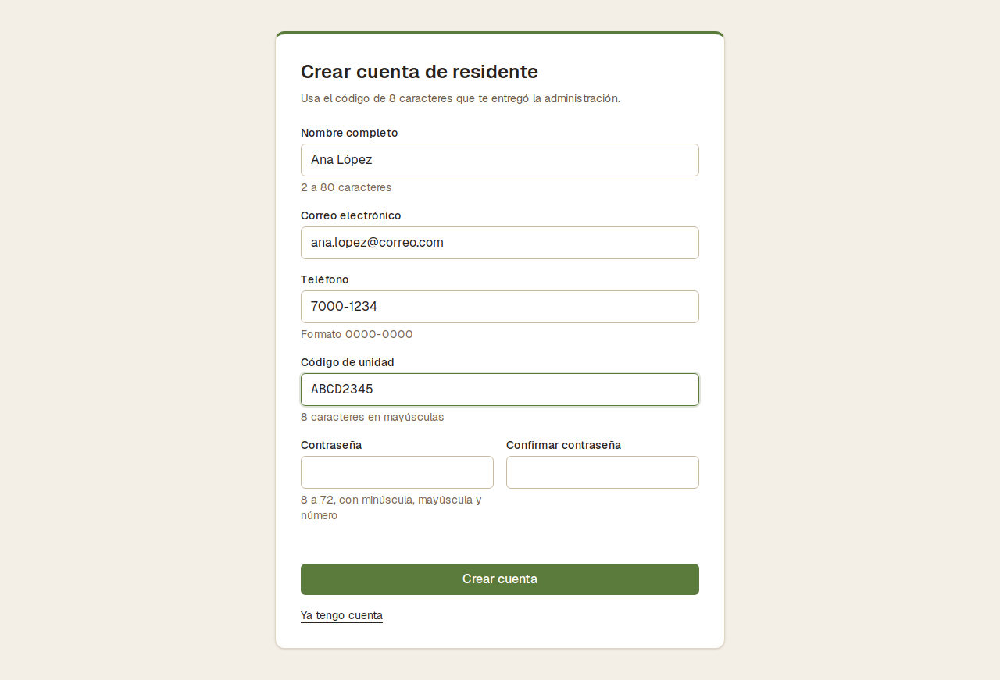

### Módulo 1: Cuotas y pagos

#### Pagar una cuota (Residente)

1. Abrir "Estado de cuenta" en el menú y presionar "Pagar" en una cuota Pendiente o Morosa.
2. Revisar el periodo, el concepto, el vencimiento y el monto total.
3. Escribir el número de tarjeta (16 dígitos), el vencimiento (MM/AA), el código de seguridad (3 dígitos) y el nombre del titular.
4. Presionar "Pagar cuota". La pasarela es simulada y responde en unos 2 segundos. La tarjeta 4242 4242 4242 4242 se aprueba, la 4000 0000 0000 0002 se rechaza por fondos insuficientes y cualquier otra se rechaza como no reconocida.
5. Si se aprueba, la cuota pasa a Pagado y se abre el recibo con el número de transacción, la unidad, el titular y los últimos 4 dígitos de la tarjeta. Si se rechaza, la pantalla muestra el motivo y la cuota sigue igual. En los dos casos el residente recibe una notificación.

Volver a enviar el mismo formulario no cobra dos veces: el backend reconoce la llave de idempotencia y devuelve el mismo pago. El sistema guarda solo los últimos 4 dígitos de la tarjeta; el número completo y el código de seguridad no se guardan.

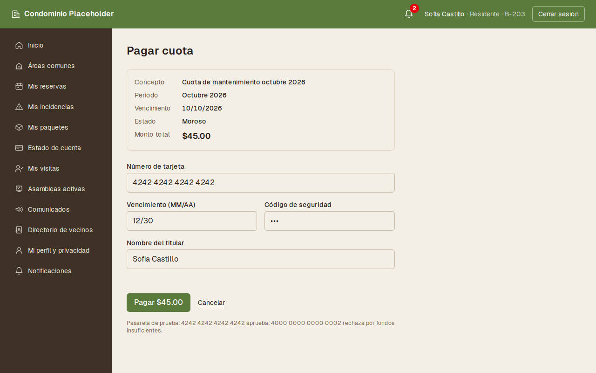

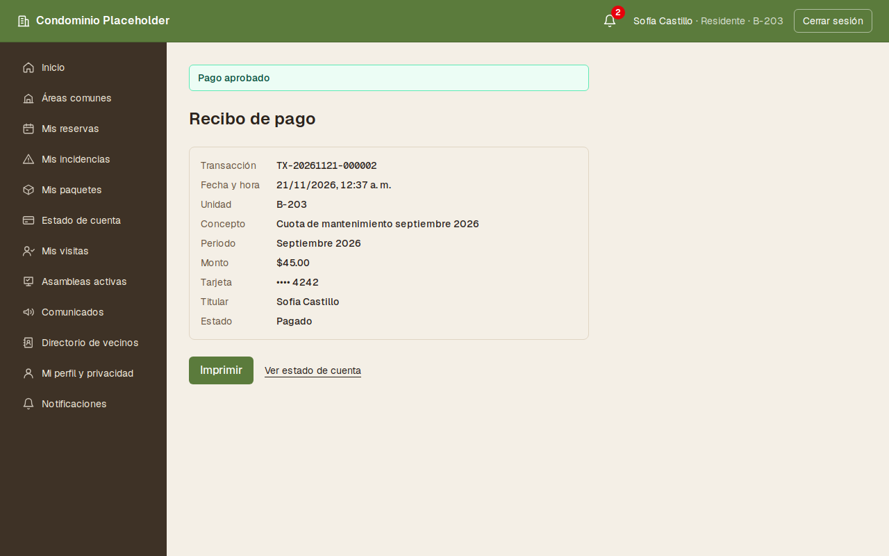

#### Consultar el estado de cuenta (Residente)

1. Abrir "Estado de cuenta" en el menú.
2. Las tarjetas muestran el saldo pendiente, la cantidad de cuotas morosas y el próximo vencimiento de la unidad.
3. La tabla lista las cuotas de la más reciente a la más antigua, 12 por página, con su periodo, concepto, monto, vencimiento y estado.
4. Los filtros de año y de estado (Pendiente, Pagado o Moroso) acotan la lista.
5. "Ver pagos" despliega los intentos de pago de una cuota, aprobados y rechazados, con el enlace a cada recibo.

El residente solo ve la unidad a la que pertenece. Los residentes de una misma unidad ven el mismo estado de cuenta.

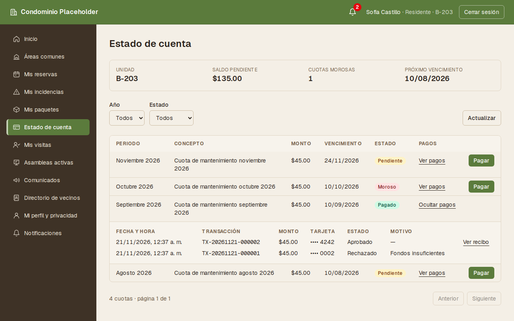

#### Consultar una unidad y su código de registro (Administrador)

1. Abrir "Unidades" en el menú, elegir una torre y luego una unidad.
2. La pantalla muestra el código de registro vigente, los residentes registrados y el estado de cuenta de la unidad en solo lectura.
3. "Copiar" copia el código para entregarlo a un residente nuevo.
4. "Regenerar código" pide confirmar y crea un código nuevo. El anterior deja de servir para registrarse; las cuentas ya creadas no cambian.

#### Generar las cuotas del mes (Administrador)

1. Abrir "Generar cuotas" en el menú.
2. Elegir el periodo: el mes actual o uno de los tres siguientes.
3. Escribir el monto por unidad (entre $1.00 y $5,000.00). La fecha de vencimiento propone el día 10 del periodo y el concepto se llena solo, pero los dos se pueden cambiar.
4. Presionar "Generar". El sistema indica cuántas unidades activas recibirán la cuota y pide confirmar.
5. Al confirmar, muestra cuántas cuotas se crearon y cuántas se omitieron porque la unidad ya tenía cuota de ese periodo. La generación queda en el historial de la derecha.

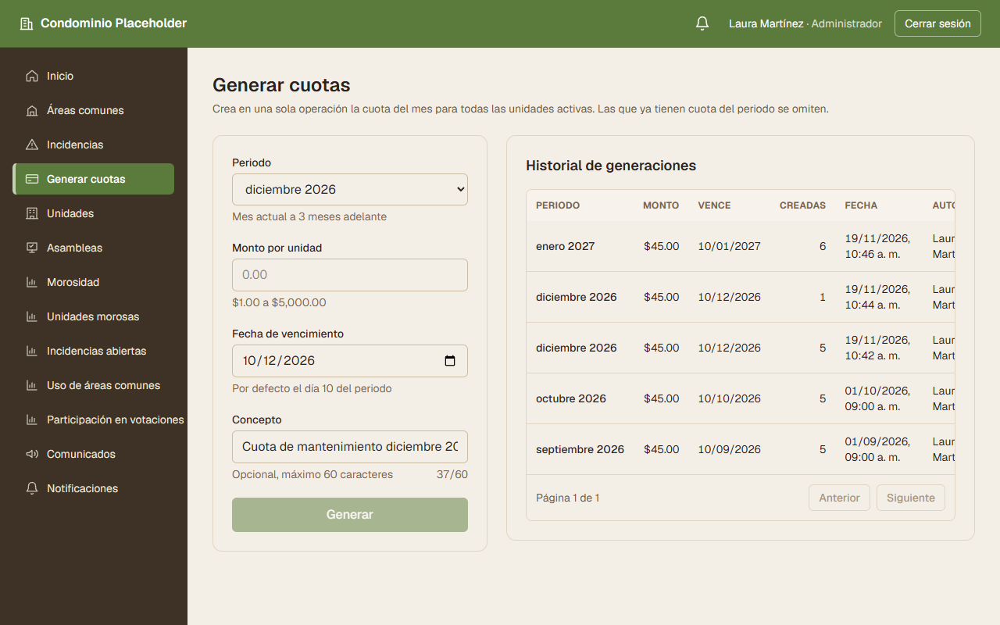

#### Consultar las unidades morosas (Administrador)

1. Abrir "Unidades morosas" en el menú.
2. Las tarjetas muestran cuántas unidades están morosas, el monto moroso total y el porcentaje sobre las unidades activas.
3. La tabla lista cada unidad con sus residentes, la cantidad de cuotas en mora, el monto, la fecha desde la que está morosa y los días en mora, de la más antigua a la más reciente.
4. Para acotar la lista, elegir una torre o escribir parte del código de la unidad. La búsqueda se aplica al dejar de escribir o al presionar Enter.
5. Al hacer clic en una fila se abre el estado de cuenta de esa unidad en solo lectura.

"Morosidad", en el mismo menú, es otro reporte (H32): resume lo adeudado en un rango de fechas de vencimiento.

#### Recordatorios y paso a Moroso (automático)

El backend corre dos tareas todos los días, en hora de El Salvador:

- **00:05:** las cuotas Pendiente que vencieron hace más de 30 días pasan a Moroso, y los residentes de la unidad reciben la notificación "Cuota en mora".
- **08:00:** las cuotas Pendiente que vencen en 5 días o menos generan la notificación "Cuota por vencer", una sola vez por cuota.

Las notificaciones aparecen en la campana y en "Notificaciones" del residente, y las cuotas morosas se reflejan en el estado de cuenta y en "Unidades morosas". Para correr las dos tareas sin esperar el horario, el administrador puede usar `POST /api/v1/cuotas/tareas/ejecutar` desde Swagger. Repetirla no duplica cambios ni notificaciones.

### Módulo 2: Reservas de áreas comunes

#### Consultar la disponibilidad (Residente y Administrador)

1. Abrir "Áreas comunes" en el menú. Aparecen las áreas habilitadas, por nombre, con su aforo y su horario.
2. Elegir un área y una fecha entre hoy y 30 días después.
3. La pantalla muestra las franjas del día con su estado: Disponible, Reservado, Mantenimiento o Pasado. Las franjas de la propia unidad se marcan como "Reservado por tu unidad".
4. "Actualizar" vuelve a consultar las franjas sin cambiar la fecha.

El Administrador ve la misma pantalla en `/reservas`, sin la opción de reservar.

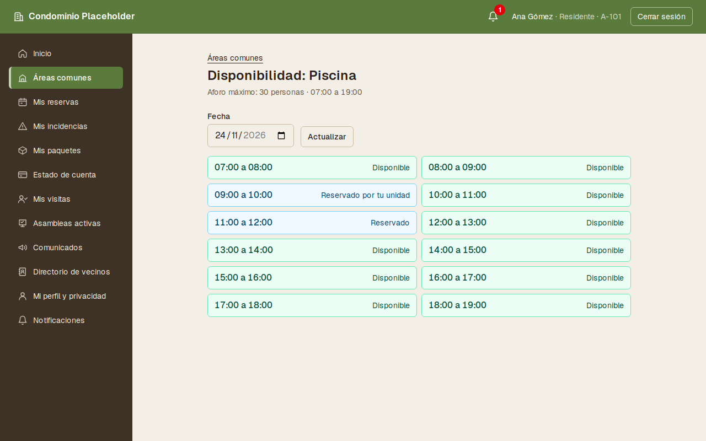

#### Reservar un área (Residente)

1. En la disponibilidad, elegir una franja Disponible.
2. En la confirmación, revisar el área, la fecha, la franja y las reglas de uso.
3. Escribir el número de personas (como máximo el aforo del área) y marcar la aceptación de las reglas.
4. Presionar "Confirmar reserva". El sistema muestra el comprobante con el número de reserva y el residente recibe la notificación "Reserva confirmada".

Una unidad puede tener como máximo 2 reservas activas. Si otra unidad toma la franja antes de confirmar, la pantalla regresa a la disponibilidad con el aviso y las franjas al día.

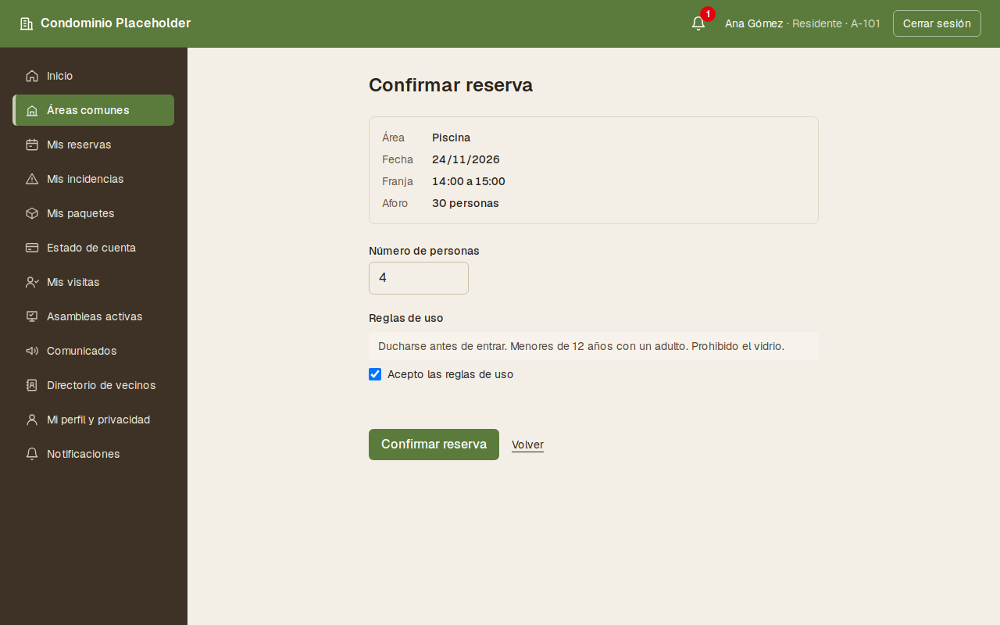

#### Ver y cancelar mis reservas (Residente)

1. Abrir "Mis reservas" en el menú.
2. La pestaña "Próximas" lista las reservas confirmadas que todavía no empiezan. "Historial" lista las pasadas y las canceladas. Las dos muestran 10 por página.
3. Cada fila indica el número de reserva, el área, la fecha, la franja, las personas, el estado y quién reservó. Se ven las reservas de toda la unidad.
4. "Cancelar" aparece solo cuando faltan al menos 24 horas para el inicio. Al confirmar, la reserva pasa a Cancelada, la franja se libera y el residente que la hizo recibe la notificación.

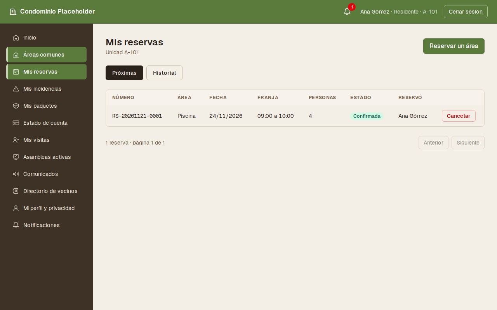

#### Administrar áreas, horarios y bloqueos (Administrador)

1. Abrir "Áreas comunes" en el menú. La tabla lista todas las áreas, habilitadas y deshabilitadas, con su horario, su aforo y sus reservas futuras.
2. "Nueva área" pide el nombre (3 a 50 caracteres), el aforo (1 a 500 personas), las reglas de uso (opcional, hasta 500 caracteres), la hora de apertura y de cierre en pasos de 30 minutos y la duración de la franja (60 o 120 minutos).
3. "Editar", en la fila del área, abre la edición: ahí se cambian esos datos o se deshabilita el área. Las áreas no se borran.
4. En la misma pantalla, "Nuevo bloqueo" cierra el área por mantenimiento entre dos fechas (de hoy en adelante, hasta 90 días) con un motivo de 5 a 200 caracteres.
5. Si un cambio de horario, la deshabilitación o un bloqueo afecta reservas confirmadas, el sistema indica cuántas se cancelarán y pide "Continuar". Al continuar, esas reservas pasan a Cancelada por la administración y cada residente afectado recibe una notificación con el motivo.
6. "Eliminar bloqueo" quita el bloqueo. Las reservas que ya canceló no se restauran.

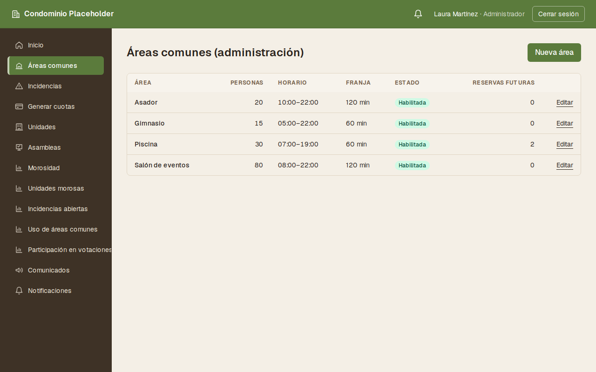

### Módulo 3: Incidencias y mantenimiento

#### Reportar una incidencia (Residente)

1. Abrir "Mis incidencias" y presionar "Reportar incidencia".
2. Escribir el título (5 a 80 caracteres) y la descripción del problema (10 a 1,000 caracteres).
3. Elegir la ubicación (una torre o un área común) y, si hace falta, escribir una referencia, por ejemplo "Piso 3, pasillo norte".
4. Adjuntar de 1 a 3 fotografías JPG o PNG de hasta 5 MB cada una y presionar "Registrar".
5. El sistema muestra el número de la incidencia. Queda en estado Pendiente y con prioridad Media.

#### Dar seguimiento a mis incidencias (Residente)

1. Abrir "Mis incidencias". La lista muestra las incidencias de la unidad, de la más reciente a la más antigua, con su estado.
2. Al abrir una incidencia se ven sus fotos, el responsable asignado y el historial: cada cambio de estado, prioridad o responsable con su fecha, hora y observación.
3. Cada cambio de estado también llega como notificación a la campana.

#### Priorizar y asignar incidencias (Administrador)

1. Abrir "Incidencias" en el menú. La bandeja muestra todas las incidencias ordenadas por prioridad (Alta, Media, Baja) y, dentro de cada una, la más antigua primero, con los días que lleva abierta.
2. Para acotar la lista, filtrar por estado, prioridad, ubicación o responsable, o buscar por número o título. La lista se actualiza sola cada 60 segundos.
3. Abrir una incidencia y, en el panel "Gestión", cambiar la prioridad o elegir un responsable de mantenimiento. Presionar "Guardar": el sistema muestra "Cambios guardados" y el historial agrega el cambio.

#### Atender una incidencia hasta resolverla (Administrador)

1. En el detalle de la incidencia, con un responsable asignado, presionar "Iniciar atención".
2. Escribir una observación de 10 a 500 caracteres con el trabajo que inicia y confirmar. La incidencia pasa a En proceso.
3. Cuando el trabajo termina, presionar "Marcar como resuelta", escribir las acciones realizadas y confirmar.
4. Si el problema vuelve, "Reabrir" la regresa a En proceso con el motivo de la reapertura.
5. En cada cambio, el residente que la reportó recibe una notificación con el nuevo estado y la observación.

### Módulo 4: Control de acceso de visitas

#### Preautorizar una visita (Residente)

1. Abrir "Mis visitas" y presionar "Autorizar visita".
2. Escribir el nombre completo del visitante y elegir el tipo de documento (DUI o Pasaporte) con su número.
3. Elegir la fecha de la visita (de hoy a 30 días) y la hora estimada de llegada, entre las 06:00 y las 22:00 en pasos de 15 minutos.
4. Escribir el motivo de la visita y presionar "Autorizar".
5. El sistema muestra el código de 6 caracteres, el visitante, la fecha y la vigencia. El código solo sirve el día de la visita, de 06:00 a 22:00. "Copiar código" lo copia para compartirlo con el visitante, que lo presenta en portería.

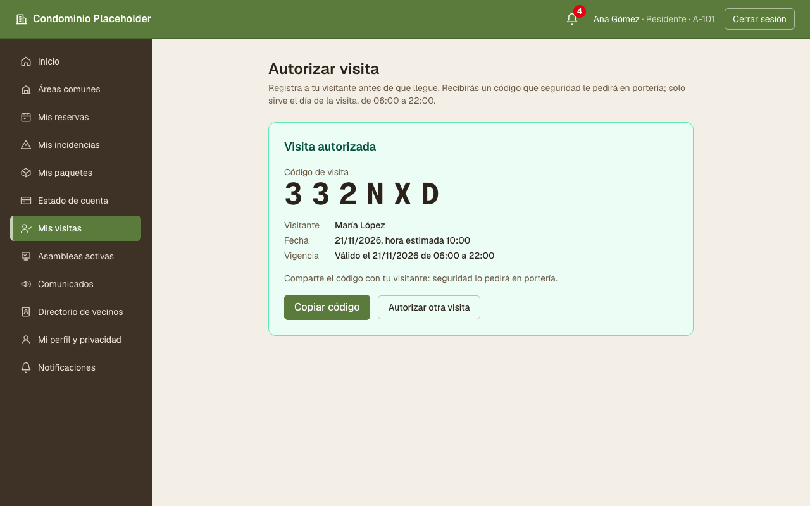

#### Ver mis visitas, cancelar y responder solicitudes (Residente)

1. Abrir "Mis visitas". La pestaña "Activas" muestra primero las solicitudes de portería que esperan respuesta y después las visitas autorizadas de hoy en adelante. "Historial" muestra las demás.
2. Para cancelar una autorización, presionar "Cancelar" en la visita y confirmar. El código deja de servir.
3. Cuando un visitante llega sin aviso, el residente recibe la notificación "Visitante en portería" y la visita aparece con el aviso "Seguridad espera tu respuesta" y los minutos que quedan.
4. Presionar "Aprobar" o "Rechazar" (con un motivo opcional). Seguridad recibe la respuesta al instante. Si nadie de la unidad responde en 15 minutos, la solicitud se rechaza sola.

#### Registrar la entrada de un visitante (Personal de seguridad)

1. Abrir "Entradas" en el menú.
2. Escribir el código de 6 caracteres que trae el visitante o su número de documento y presionar "Buscar".
3. Si la autorización está vigente, presionar "Registrar entrada". El sistema muestra "Entrada registrada a las HH:mm" y el visitante aparece en "Quién está dentro".
4. Si el visitante no tiene autorización, presionar "Visitante sin autorización", llenar su nombre, documento, torre, unidad y motivo, y presionar "Enviar solicitud". Los residentes de la unidad reciben la notificación.
5. La solicitud queda en "Esperando respuesta", que se actualiza cada 15 segundos. Si el residente la aprueba, aparece "Aprobada" y el botón "Registrar entrada"; si la rechaza o pasan 15 minutos, aparece "Rechazada" con el motivo.

#### Consultar quién está dentro (Personal de seguridad)

1. Abrir "Quién está dentro" en el menú.
2. La tarjeta "Visitantes dentro" muestra el total del condominio. La tabla lista las visitas en estado Dentro, de la entrada más antigua a la más reciente, con visitante, documento, unidad, motivo, hora de entrada y tiempo dentro. Una visita de un día anterior sin salida sigue en la lista y su entrada muestra la fecha.
3. Para filtrar, elegir una torre o escribir parte del nombre o del documento en "Buscar". La búsqueda no distingue mayúsculas ni tildes.
4. La lista se actualiza cada 30 segundos mientras la pantalla está abierta, al volver a la pestaña y con el botón "Actualizar". Sin visitantes dentro muestra "No hay visitantes dentro del condominio.".

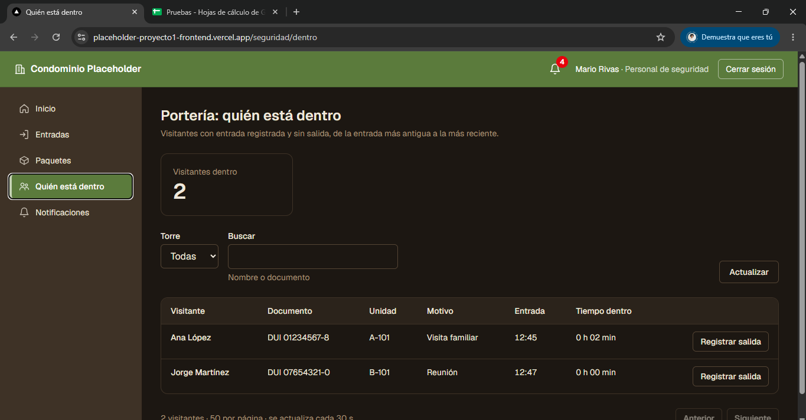

#### Registrar la salida de un visitante (Personal de seguridad)

1. En "Quién está dentro", presionar "Registrar salida" en la fila del visitante.
2. Confirmar en la ventana "¿Registrar la salida de <visitante>?".
3. El sistema muestra "Salida registrada a las HH:mm" con la hora del servidor, la fila desaparece y el total baja. La torre, la búsqueda y la página se conservan.
4. Si otro agente ya registró la salida, la lista se recarga y muestra "Este visitante no tiene una entrada activa.".

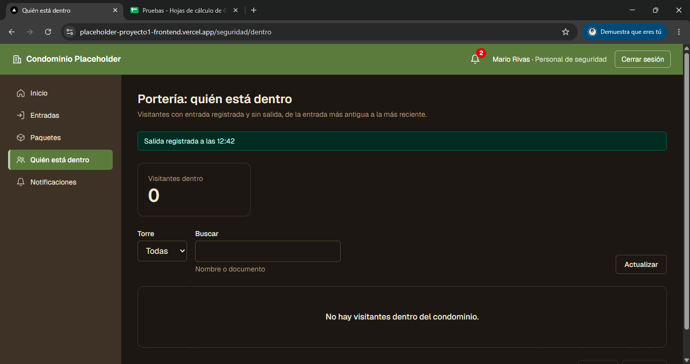

### Módulo 5: Paquetería

#### Registrar la llegada de un paquete (Personal de seguridad)

1. Abrir "Paquetes" en el menú y presionar "Registrar paquete".
2. Elegir la torre y la unidad destino, escribir la empresa de mensajería y, si se tienen, el número de guía y las observaciones.
3. Presionar "Registrar". El paquete recibe un código `PQ-AAAAMMDD-NNNN` y queda Pendiente de entrega.
4. Los residentes de la unidad reciben la notificación "Tienes un paquete en portería" con la empresa y el código.
5. La lista muestra los paquetes pendientes, 20 por página, y se puede buscar por código, guía o unidad.

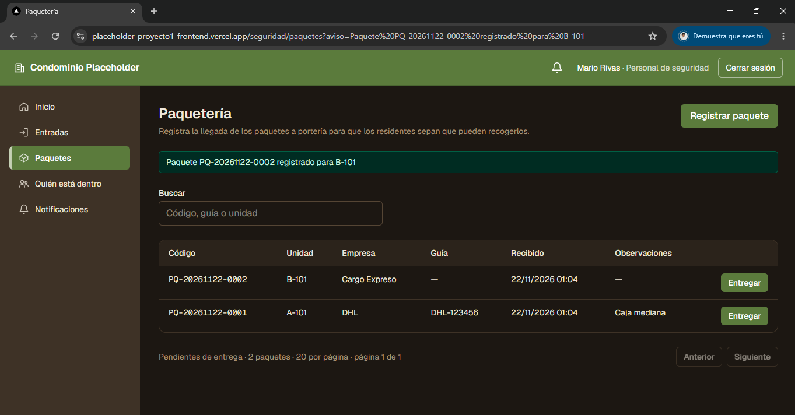

#### Consultar mis paquetes (Residente)

1. Abrir "Mis paquetes" en el menú.
2. La pestaña de pendientes muestra los paquetes de la unidad que esperan en portería, con los días de espera. La de entregados muestra quién recogió cada paquete y cuándo, con solo los últimos 4 caracteres de su documento.
3. Cada residente ve solo los paquetes de su unidad.

#### Entregar un paquete (Personal de seguridad)

1. En "Paquetes", presionar "Entregar" en la fila del paquete.
2. Revisar el resumen del paquete, escribir el nombre de quien recoge y elegir DUI o Pasaporte con su número.
3. Presionar "Confirmar entrega" y confirmar en la ventana. El paquete pasa a Entregado y la lista muestra "Paquete entregado".
4. Los residentes de la unidad reciben la notificación "Paquete entregado" con quién lo recogió, la fecha y la hora.
5. Si otro agente ya lo entregó, la lista se recarga y muestra "Este paquete ya fue entregado el <fecha> a <nombre>.".

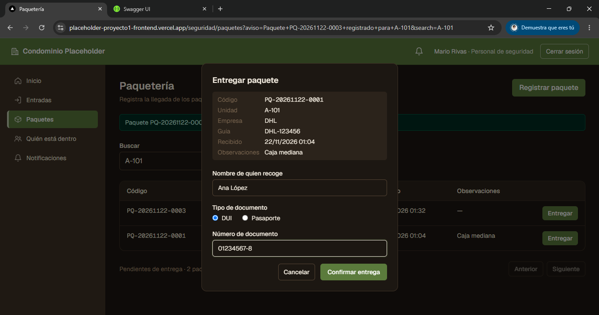

### Módulo 6: Asambleas y votaciones

#### Convocar una asamblea (Administrador)

1. Abrir "Asambleas" en el menú y presionar "Convocar asamblea".
2. Escribir el título (5 a 100 caracteres), la descripción opcional y las fechas de inicio y cierre. El inicio debe ser al menos 1 hora después de ahora y el cierre, entre 1 hora y 14 días después del inicio.
3. Agregar de 1 a 10 temas. Cada tema lleva su pregunta (5 a 200 caracteres) y de 2 a 6 opciones distintas.
4. Presionar "Guardar". La asamblea queda Programada y se puede editar o eliminar hasta que inicia.
5. Una tarea automática revisa cada minuto las fechas. Al llegar el inicio, la asamblea pasa a Abierta, fija las unidades habilitadas (las que tienen al menos un residente activo) y avisa a todos los residentes. Al llegar el cierre, pasa a Cerrada.

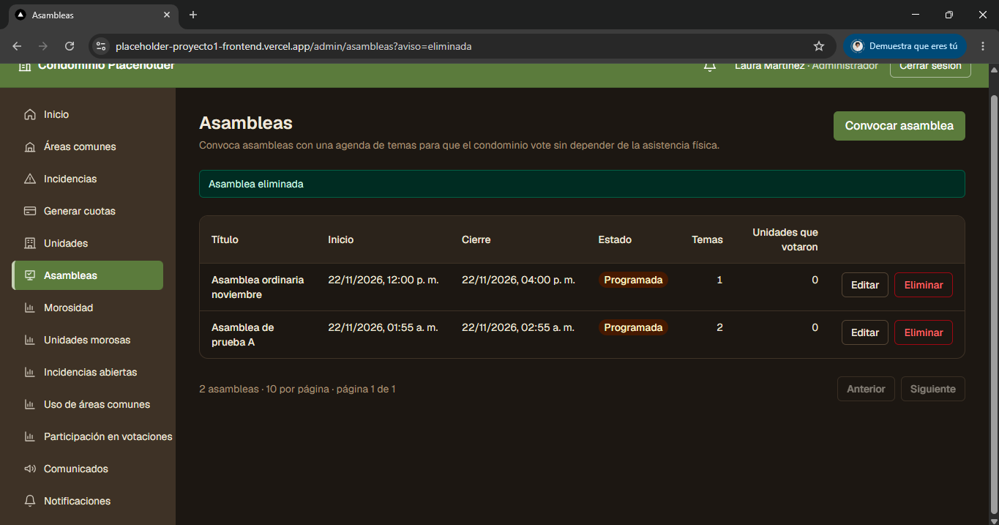

#### Votar en una asamblea (Residente)

1. Abrir "Asambleas activas". Cada tarjeta muestra el cierre y el progreso de la unidad, por ejemplo "Tu unidad votó 1 de 3 temas".
2. Entrar a la asamblea, elegir una opción en un tema y presionar "Votar".
3. Confirmar en la ventana. El voto es definitivo y secreto, y cuenta uno por unidad en cada tema.
4. El tema muestra "Ya votaste", o "Tu unidad ya votó" si votó otro residente, con la fecha y la hora, sin mostrar la opción elegida.

#### Consultar el resultado de una asamblea (Administrador y Residente)

1. El administrador presiona "Resultado" en la lista de asambleas. El residente abre "Asambleas activas", luego "Asambleas cerradas" y presiona "Ver resultado".
2. Mientras la asamblea está Programada se muestra "La asamblea todavía no inicia.". Mientras está Abierta se muestra cuántas unidades han votado cada tema, sin conteos, y "Los resultados se publican al cierre.".
3. Con la asamblea Cerrada, cada tema muestra las unidades habilitadas, las que votaron con su porcentaje, la opción ganadora (o "Empate" o "Sin votos") y los votos y el porcentaje de cada opción.
4. El registro de participación lista la unidad y la hora de cada voto, sin la opción elegida, 50 por página.

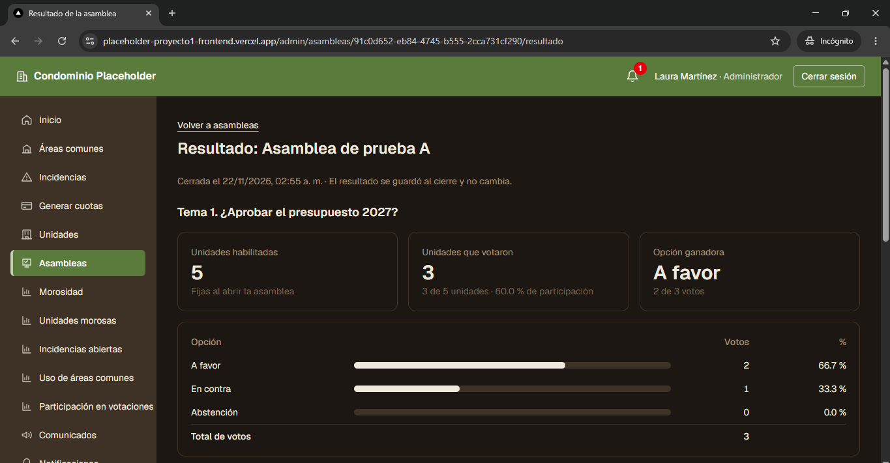

### Módulo 7: Anuncios y comunicados

#### Publicar un comunicado (Administrador)

1. Abrir "Comunicados" y presionar "Nuevo comunicado".
2. Escribir el título (5 a 100 caracteres) y el contenido (10 a 2,000).
3. Elegir la categoría y la fecha de fin de vigencia (de mañana a 90 días).
4. Dejar marcado "Todo el condominio" o elegir una o más torres.
5. Presionar "Publicar". El comunicado llega a los residentes de esa audiencia y cada uno recibe una notificación.

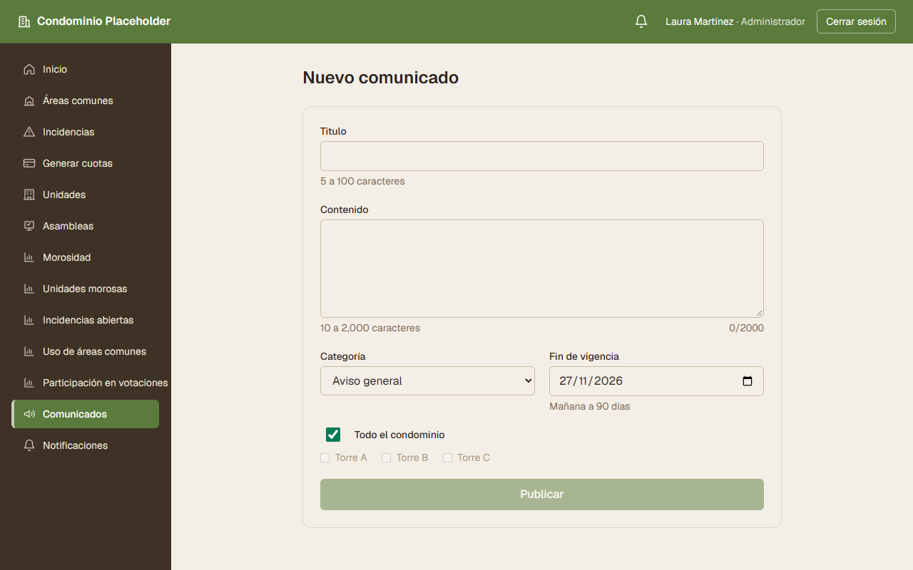

#### Revisar quién leyó un comunicado (Administrador)

1. En "Comunicados", la tabla lista lo publicado, del más reciente al más antiguo, con su estado (Vigente o Archivado) y las lecturas: cuántos residentes lo leyeron de cuántos lo recibieron.
2. Los filtros de estado y categoría acotan la lista.
3. Al abrir un comunicado se ve su contenido completo y la tabla de destinatarios, ordenada por unidad, con la fecha y hora de lectura de cada uno.
4. El filtro "Lectura" muestra todos, solo los que leyeron o solo los que no.

#### Consultar comunicados (Residente)

1. Abrir "Comunicados" en el menú. Aparecen los comunicados de los que el residente es destinatario, con los no leídos marcados.
2. Las pestañas separan los vigentes de los archivados, y el filtro de categoría acota la lista.
3. Al abrir un comunicado se muestra completo y queda marcado como leído. Esa lectura es la que ve el administrador.

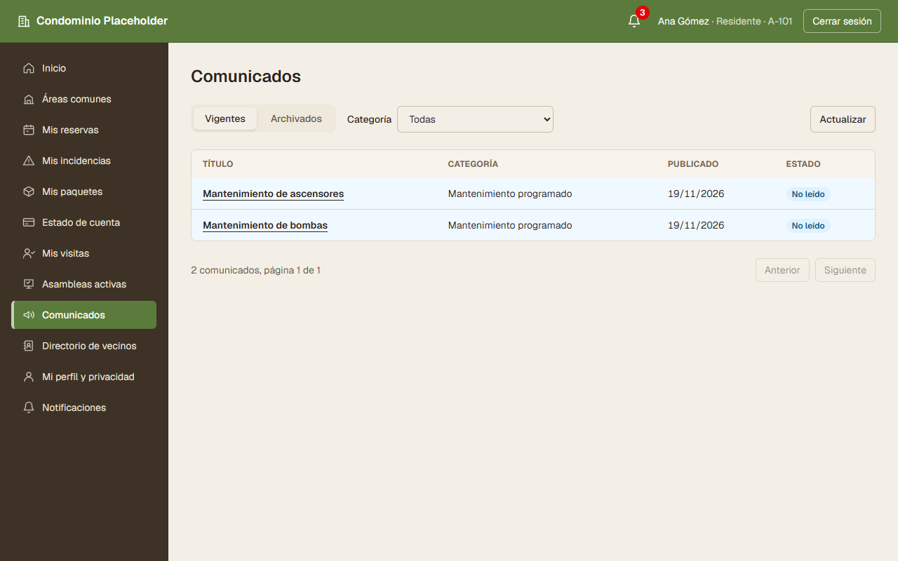

### Módulo 8: Directorio de residentes

#### Configurar la privacidad (Residente)

1. Abrir "Mi perfil y privacidad". El nombre, el correo y la unidad son de solo lectura.
2. El teléfono se puede editar, con el formato 0000-0000.
3. Marcar "Aparecer en el directorio" y elegir qué datos se comparten: nombre, unidad, teléfono y correo.
4. El recuadro "Así te verán tus vecinos" muestra el resultado antes de guardar.
5. Presionar "Guardar".

#### Buscar a un vecino (Residente)

1. Abrir "Directorio de vecinos".
2. Buscar por nombre (al menos 3 caracteres, sin importar mayúsculas ni tildes) o por torre y número de unidad.
3. Cada resultado muestra solo los datos que ese vecino decidió compartir. Quien oculta su unidad no aparece en la búsqueda por unidad, y el propio residente no aparece en sus resultados.

### Módulo 9: Notificaciones

#### Consultar las notificaciones (todos los roles)

1. La campana del encabezado muestra cuántas notificaciones no leídas hay (99+ si son más de 99) y se actualiza cada 30 segundos.
2. Al presionar la campana, o "Notificaciones" en el menú, se abre la bandeja, de la más reciente a la más antigua, 20 por página.
3. El filtro "Módulo de origen" acota la lista y "Estado" muestra todas o solo las no leídas.
4. Al abrir una notificación se marca como leída y, si tiene un registro de origen, lleva a esa pantalla.
5. "Marcar todas como leídas" pide confirmar y marca todas las no leídas.

### Módulo 10: Reportes para la administración

#### Resumen del condominio (Administrador)

1. Al iniciar sesión, el administrador entra a "Resumen del condominio". También se abre con "Inicio" en el menú.
2. La pantalla muestra cuatro tarjetas: Morosidad (últimos 12 meses), Áreas comunes (mes actual), Incidencias (abiertas hoy y con más de 7 días) y Votaciones (última asamblea cerrada).
3. Cada tarjeta tiene "Ver reporte", que abre el reporte completo. Una tarjeta sin datos muestra "Sin datos".
4. "Actualizar" vuelve a consultar las cifras. La hora de la última actualización aparece bajo el título.

#### Panel de morosidad (Administrador)

1. Abrir "Morosidad" en el menú.
2. Elegir el rango de fechas de vencimiento. Por defecto son los últimos 12 meses, con un máximo de 366 días. El reporte se actualiza al cambiar una fecha válida.
3. Las tarjetas muestran el monto adeudado (cuotas Pendiente y Moroso), las unidades morosas y el porcentaje sobre las unidades activas.
4. La tabla lista cada unidad morosa con su monto y los días de antigüedad, de la más antigua a la más reciente, 20 por página.

#### Uso de áreas comunes (Administrador)

1. Abrir "Uso de áreas comunes" en el menú.
2. Elegir el periodo: "Mes actual", "Últimos 3 meses" o "Personalizado". Las fechas solo se editan en "Personalizado", con un máximo de 366 días.
3. Las tarjetas muestran el área más usada y la menos usada, con su ocupación.
4. La tabla lista cada área habilitada con sus reservas confirmadas y canceladas, las horas reservadas, las horas habilitadas y la ocupación. Las canceladas no suman horas y los días con bloqueo no cuentan como habilitados.

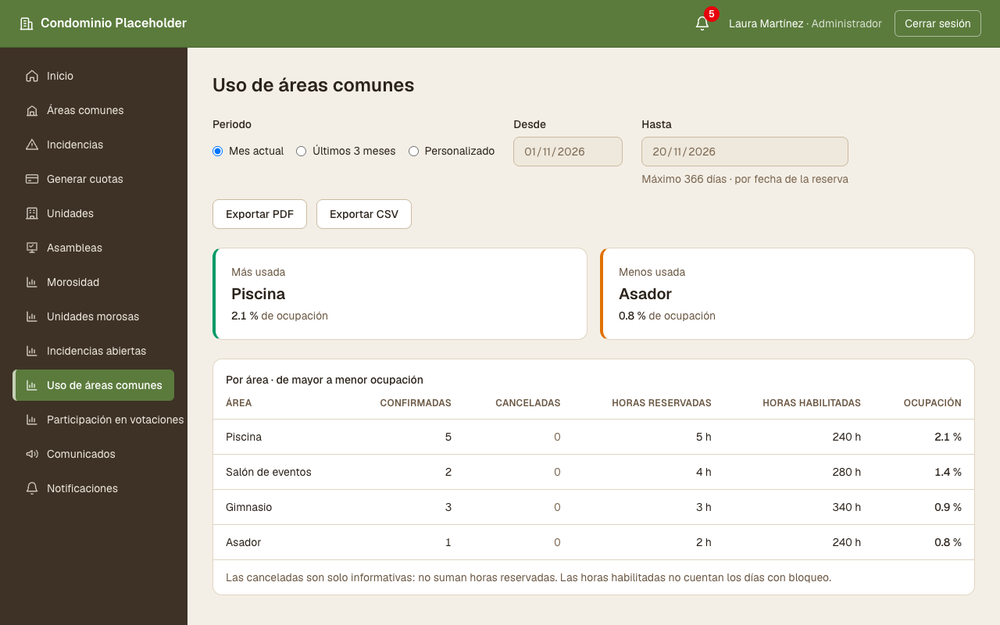

#### Incidencias abiertas (Administrador)

1. Abrir "Incidencias abiertas" en el menú.
2. Elegir el periodo, con las mismas opciones que el reporte de uso de áreas. Filtra por fecha de creación.
3. Las tarjetas muestran las incidencias abiertas (Pendiente y En proceso) creadas en el periodo y el tiempo promedio de resolución.
4. La tabla cruza el estado con la prioridad de las incidencias creadas en el periodo.
5. "Abiertas con más de 7 días" lista las incidencias abiertas hoy que llevan más de 7 días, sin importar el periodo, de la más antigua a la más reciente.

#### Participación en votaciones (Administrador)

1. Abrir "Participación en votaciones" en el menú.
2. Elegir una asamblea en la lista o dejar "Todas" y elegir el rango de fechas de apertura. Por defecto son los últimos 12 meses. Con una asamblea elegida, las fechas no se aplican.
3. Cada asamblea, abierta o cerrada, muestra su estado, su fecha de apertura y el promedio de participación.
4. La tabla de cada asamblea muestra, por tema, cuántas unidades votaron, cuántas estaban habilitadas y el porcentaje. El reporte nunca muestra qué opción eligió cada unidad.

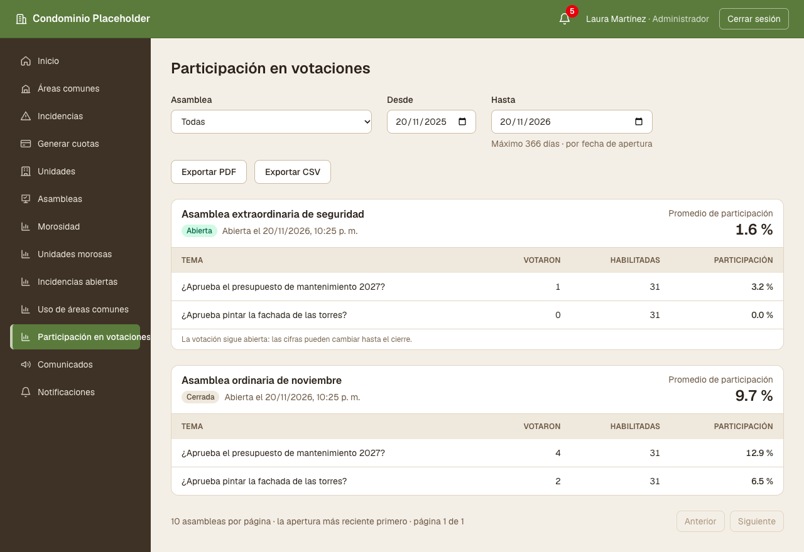

#### Exportar un reporte a PDF o CSV (Administrador)

1. En cualquiera de los cuatro reportes anteriores, presionar "Exportar PDF" o "Exportar CSV".
2. El archivo usa los mismos filtros que se ven en pantalla. Mientras se genera, el botón muestra "Generando..." y los dos botones quedan deshabilitados.
3. El navegador descarga el archivo con el nombre `<reporte>_<desde>_<hasta>.pdf` o `.csv`, por ejemplo `morosidad_2025-11-20_2026-11-20.pdf`.
4. El PDF incluye el título, los filtros, la fecha y hora de generación, el administrador que lo generó, las cifras resumen y la tabla completa. El CSV trae la tabla completa, en UTF-8 con BOM para que Excel muestre bien las tildes.
5. Si el reporte supera 5,000 filas, se muestra "El reporte supera 5,000 filas. Reduce el rango.".

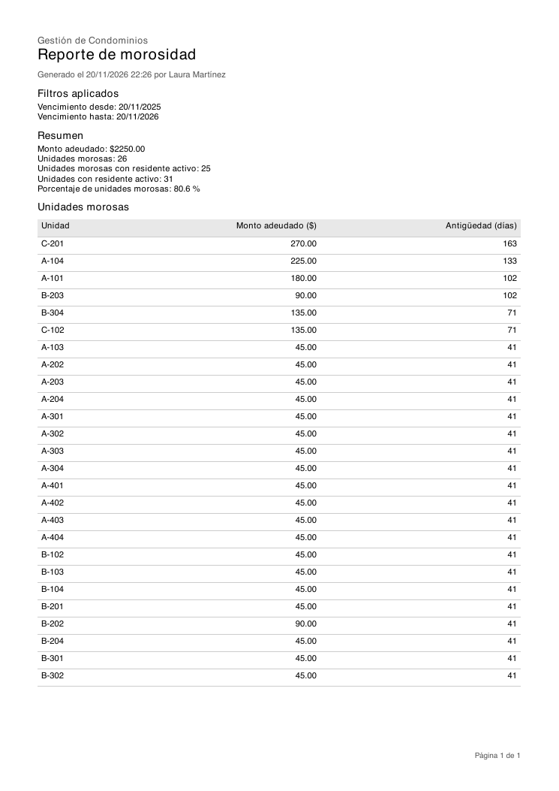
