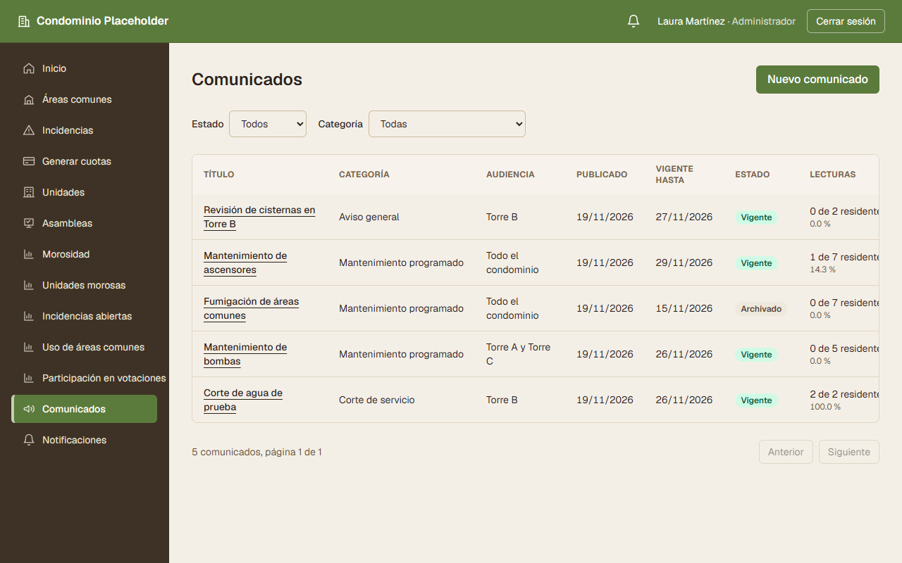
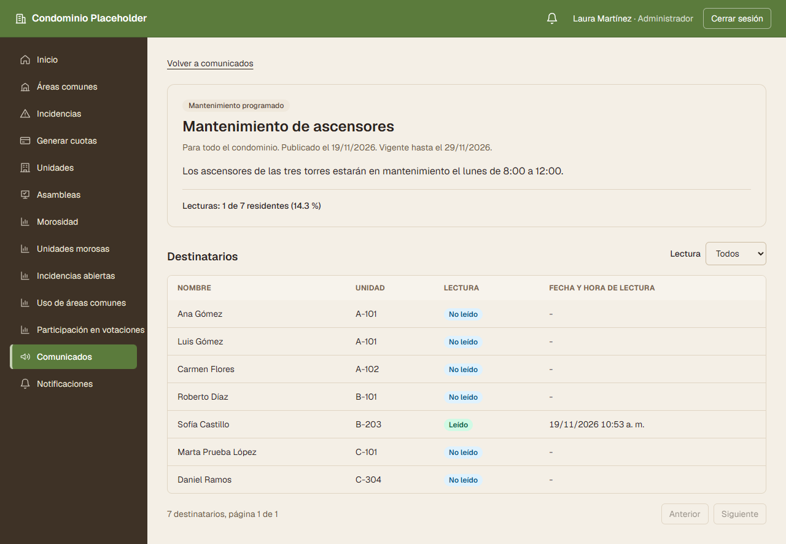
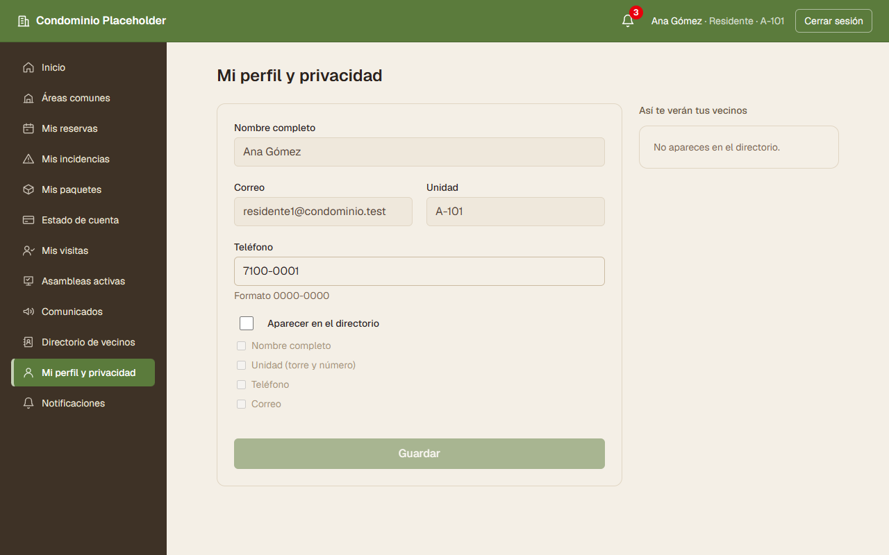

<!-- Cada responsable agrega aquí los flujos de sus módulos, con capturas en docs/img/. Borrar este comentario antes de entregar. -->

# Guía de uso

## Roles

| Rol | Qué puede hacer |
|---|---|
| Administrador | Configura áreas comunes, genera cuotas, gestiona incidencias, convoca asambleas, publica comunicados y consulta los reportes. |
| Residente | Paga sus cuotas, reserva áreas comunes, reporta incidencias, autoriza visitas, recibe paquetes, vota en asambleas, lee comunicados y busca vecinos en el directorio. |
| Personal de seguridad | Registra la entrada y salida de visitantes, consulta quién está dentro y registra la llegada y entrega de paquetes. |

Cada rol ve en el menú lateral solo sus opciones. Si alguien abre la ruta de otro rol, la pantalla muestra "No tienes permiso para ver esta página." y el backend responde 403.

## Flujos principales

### Módulo 1: Cuotas y pagos

<!-- H1 y H2 (pago de cuotas y estado de cuenta): Carlos. -->

#### Generar las cuotas del mes (Administrador)

1. Abrir "Generar cuotas" en el menú.
2. Elegir el periodo: el mes actual o uno de los tres siguientes.
3. Escribir el monto por unidad (entre $1.00 y $5,000.00). La fecha de vencimiento propone el día 10 del periodo y el concepto se llena solo, pero los dos se pueden cambiar.
4. Presionar "Generar". El sistema indica cuántas unidades activas recibirán la cuota y pide confirmar.
5. Al confirmar, muestra cuántas cuotas se crearon y cuántas se omitieron porque la unidad ya tenía cuota de ese periodo. La generación queda en el historial de la derecha.

#### Consultar las unidades morosas (Administrador)

1. Abrir "Unidades morosas" en el menú.
2. Las tarjetas muestran cuántas unidades están morosas, el monto moroso total y el porcentaje sobre las unidades activas.
3. La tabla lista cada unidad con sus residentes, la cantidad de cuotas en mora, el monto, la fecha desde la que está morosa y los días en mora, de la más antigua a la más reciente.
4. Para acotar la lista, elegir una torre o escribir parte del código de la unidad. La búsqueda se aplica al dejar de escribir o al presionar Enter.
5. Al hacer clic en una fila se abre el estado de cuenta de esa unidad en solo lectura.

"Morosidad", en el mismo menú, es otro reporte (H32): resume lo adeudado en un rango de fechas de vencimiento.

#### Recordatorios y paso a Moroso (automático)

El backend corre dos tareas todos los días, en hora de El Salvador:

- **00:05:** las cuotas Pendiente que vencieron hace más de 30 días pasan a Moroso, y los residentes de la unidad reciben la notificación "Cuota en mora".
- **08:00:** las cuotas Pendiente que vencen en 5 días o menos generan la notificación "Cuota por vencer", una sola vez por cuota.

Las notificaciones aparecen en la campana y en "Notificaciones" del residente, y las cuotas morosas se reflejan en el estado de cuenta y en "Unidades morosas". Para correr las dos tareas sin esperar el horario, el administrador puede usar `POST /api/v1/cuotas/tareas/ejecutar` desde Swagger. Repetirla no duplica cambios ni notificaciones.

### Módulo 7: Anuncios y comunicados

#### Publicar un comunicado (Administrador)

1. Abrir "Comunicados" y presionar "Nuevo comunicado".
2. Escribir el título (5 a 100 caracteres) y el contenido (10 a 2,000).
3. Elegir la categoría y la fecha de fin de vigencia (de mañana a 90 días).
4. Dejar marcado "Todo el condominio" o elegir una o más torres.
5. Presionar "Publicar". El comunicado llega a los residentes de esa audiencia y cada uno recibe una notificación.

#### Revisar quién leyó un comunicado (Administrador)

1. En "Comunicados", la tabla lista lo publicado, del más reciente al más antiguo, con su estado (Vigente o Archivado) y las lecturas: cuántos residentes lo leyeron de cuántos lo recibieron.
2. Los filtros de estado y categoría acotan la lista.
3. Al abrir un comunicado se ve su contenido completo y la tabla de destinatarios, ordenada por unidad, con la fecha y hora de lectura de cada uno.
4. El filtro "Lectura" muestra todos, solo los que leyeron o solo los que no.

#### Consultar comunicados (Residente)

1. Abrir "Comunicados" en el menú. Aparecen los comunicados de los que el residente es destinatario, con los no leídos marcados.
2. Las pestañas separan los vigentes de los archivados, y el filtro de categoría acota la lista.
3. Al abrir un comunicado se muestra completo y queda marcado como leído. Esa lectura es la que ve el administrador.

### Módulo 8: Directorio de residentes

#### Configurar la privacidad (Residente)

1. Abrir "Mi perfil y privacidad". El nombre, el correo y la unidad son de solo lectura.
2. El teléfono se puede editar, con el formato 0000-0000.
3. Marcar "Aparecer en el directorio" y elegir qué datos se comparten: nombre, unidad, teléfono y correo.
4. El recuadro "Así te verán tus vecinos" muestra el resultado antes de guardar.
5. Presionar "Guardar".

#### Buscar a un vecino (Residente)

1. Abrir "Directorio de vecinos".
2. Buscar por nombre (al menos 3 caracteres, sin importar mayúsculas ni tildes) o por torre y número de unidad.
3. Cada resultado muestra solo los datos que ese vecino decidió compartir. Quien oculta su unidad no aparece en la búsqueda por unidad, y el propio residente no aparece en sus resultados.

<!-- Módulos 2 a 6, 9 y 10: cada responsable agrega sus flujos con el mismo formato. -->
