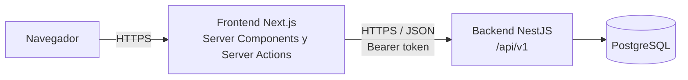

<!-- Frontend: André. Backend, base de datos y despliegue: Carlos. Borrar este comentario antes de entregar. -->

# Arquitectura

## Vista general

<!-- Carlos: ajustar las plataformas de despliegue del diagrama cuando estén definidas. -->



El navegador solo habla con el servidor de Next. Las páginas se arman en el servidor y las llamadas al backend salen de ahí, con el token de la sesión. La API no se llama desde el navegador.

## Stack

| Capa | Tecnología | Versión |
|---|---|---|
| Frontend | Next.js (App Router), React, TypeScript y Tailwind CSS | 16, 19, 5 y 4 |
| Pruebas del frontend | Vitest y Testing Library | 4 |
| Backend | [NestJS + Prisma] | [x.y] |
| Base de datos | PostgreSQL | [x.y] |
| Contenedores | Docker y docker-compose | [x.y] |

## Estructura de carpetas

### Frontend

```
app/
  (admin)/admin/     pantallas del Administrador
  (residente)/       pantallas del Residente
  (seguridad)/       pantallas del Personal de seguridad
  (comun)/           pantallas que comparten varios roles
  actions/           Server Actions
  archivos/          route handler para archivos protegidos
  _components/       layout y componentes compartidos
lib/
  api.ts             apiFetch, usuario actual y validación de rol
  session.ts         cookie de sesión
  navigation.ts      menú lateral por rol
  *-api.ts           llamadas al backend por módulo
  validation/        validaciones de formularios
proxy.ts             redirige a /login si no hay sesión
```

### Backend

```
[pegar la estructura principal del backend, dos o tres niveles]
```

## Flujo de una página del frontend

1. `proxy.ts` revisa que exista la cookie `session`. Sin ella, redirige a `/login`.
2. El `layout.tsx` del grupo de rol pide el usuario actual (`GET /auth/me`) y, si el rol no coincide, muestra "No tienes permiso".
3. La página vuelve a validar el rol con `requireRole` y consulta el backend con `apiFetch`, que agrega `Authorization: Bearer <token>`.
4. Si el backend responde 401, `apiFetch` redirige a `/sesion/expirada`, que borra la cookie y lleva a `/login` con el aviso de sesión vencida.
5. Los formularios llaman a Server Actions (`app/actions/`), que validan los datos, llaman al backend y devuelven los errores para mostrarlos junto a cada campo.

## Decisiones técnicas

| Decisión | Alternativas consideradas | Motivo |
|---|---|---|
| Token del backend en una cookie `httpOnly`, leída solo en el servidor de Next | Guardarlo en `localStorage` y llamar a la API desde el navegador | El JavaScript del navegador no puede leer el token, y la URL de la API no queda expuesta al cliente. |
| Server Components para leer datos y Server Actions para modificarlos | Componentes cliente con `fetch` y un estado global | Menos código en el cliente y una sola forma de llamar al backend (`apiFetch`). Los componentes cliente quedan para la interacción: filtros con espera, confirmaciones y actualización periódica. |
| Validar el rol en el layout del grupo y otra vez en cada página | Validarlo solo en el layout | Next ejecuta la página aunque el layout muestre el aviso. Sin la segunda validación, la página consultaría datos de otro rol. |
| Filtros y página en la URL (`?torre=...&page=2`) | Estado local del componente | Los botones Atrás y Adelante funcionan, el enlace se puede compartir y el Server Component lee los filtros sin estado en el cliente. |
| Route handler `/archivos/...` para fotos y exportaciones | Enlazar directamente a la API | Las fotos de incidencias y los PDF y CSV necesitan el token. El handler lo agrega y solo permite rutas conocidas, para no ser un proxy abierto. |
| `API_URL` leída al arrancar, con salida `standalone` | Variable `NEXT_PUBLIC_*` fijada en el build | La misma imagen de Docker sirve para local y para producción. |
| [Decisión del backend] | [...] | [...] |
