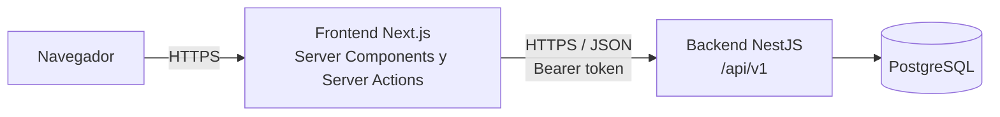
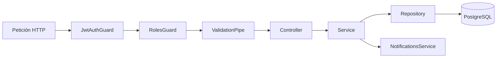

# Arquitectura

## Vista general

<!-- Carlos: ajustar las plataformas de despliegue del diagrama cuando estén definidas. -->



El navegador solo habla con el servidor de Next. Las páginas se arman en el servidor y las llamadas al backend salen de ahí, con el token de la sesión. La API no se llama desde el navegador.

## Stack

| Capa | Tecnología | Versión |
|---|---|---|
| Frontend | Next.js (App Router), React, TypeScript y Tailwind CSS | 16, 19, 5 y 4 |
| Pruebas del frontend | Vitest y Testing Library | 4 |
| Backend | NestJS, Prisma ORM y TypeScript, sobre Node.js | 12, 7, 6 y 24 |
| Tareas programadas | `@nestjs/schedule` | 12 |
| Autenticación | `@nestjs/jwt` y bcrypt | 12 y 6 |
| Documentación de la API | Swagger (`@nestjs/swagger`) | 12 |
| Pruebas del backend | Vitest | 4 |
| Base de datos | PostgreSQL | 18 |
| Contenedores | Docker y Docker Compose | Compose v2 |

## Estructura de carpetas

### Frontend

```
app/
  (admin)/admin/     pantallas del Administrador
  (residente)/       pantallas del Residente
  (seguridad)/       pantallas del Personal de seguridad
  (comun)/           pantallas que comparten varios roles
  actions/           Server Actions
  archivos/          route handler para archivos protegidos
  _components/       layout y componentes compartidos
lib/
  api.ts             apiFetch, usuario actual y validación de rol
  session.ts         cookie de sesión
  navigation.ts      menú lateral por rol
  *-api.ts           llamadas al backend por módulo
  validation/        validaciones de formularios
proxy.ts             redirige a /login si no hay sesión
```

### Backend

```
prisma/
  schema.prisma        modelos y enums
  migrations/          migraciones versionadas
  seed.ts              datos iniciales del condominio (H39)
src/
  main.ts              arranque y Swagger en /api/docs
  app.setup.ts         prefijo /api/v1 y ValidationPipe global
  app.module.ts        módulos y guards globales
  config/              validación de las variables de entorno
  prisma/              PrismaService (cliente con el adaptador de pg)
  common/              decoradores, validación y hora del condominio
  auth/                login, refresh, logout, registro y guards (H38)
  users/               cuentas y perfiles
  towers/ y units/     torres y unidades
  fees/                generación de cuotas, morosidad y tareas diarias (H3 a H5)
  payments/            pagos, pasarela simulada y estado de cuenta (H1, H2)
  reservations/        áreas comunes, disponibilidad y reservas (H6 a H9)
  incidents/           incidencias y fotos (H10 a H13)
  visits/              visitas y portería (H14 a H18)
  packages/            paquetería (H19 a H21)
  admin/assemblies/    asambleas (H22, H24)
  voting/              votación (H23)
  announcements/       comunicados (H25 a H27)
  directory/           perfil y directorio (H28, H29)
  notifications/       servicio y bandeja de notificaciones (H30, H31)
  admin/reports/       reportes y exportación (H32 a H37)
test/
  flows/               pruebas de integración por flujo
  support/             arranque de la app y base de pruebas
```

Los módulos con más lógica se dividen en `controllers/`, `services/`, `repositories/`, `dto/` y `errors/`, cada carpeta con su `index.ts`. Los módulos pequeños tienen esos archivos en la raíz de su carpeta.

## Flujo de una petición en el backend



1. `JwtAuthGuard` es global: valida el access token y vuelve a leer el usuario de la base. Las rutas públicas se marcan con `@Public()`.
2. `RolesGuard` también es global y corre después. Compara el rol del usuario con `@Roles(...)` y responde 403 si no coincide.
3. `ValidationPipe` valida el cuerpo y los parámetros con el DTO. Rechaza propiedades no declaradas y responde 400 con el mensaje y el campo (`field`).
4. El controller traduce HTTP a una llamada al servicio. El servicio aplica las reglas de la historia y el repositorio es el único que usa Prisma.
5. Los servicios que avisan a un usuario llaman a `NotificationsService` (H30). Si el aviso falla, la operación principal ya quedó guardada.

Las tareas programadas usan `@nestjs/schedule`: el paso a Moroso y los recordatorios de cuotas (H5), en hora de El Salvador, y los procesos periódicos de visitas y de asambleas.

## Flujo de una página del frontend

1. `proxy.ts` revisa que exista la cookie `session`. Sin ella, redirige a `/login`.
2. El `layout.tsx` del grupo de rol pide el usuario actual (`GET /auth/me`) y, si el rol no coincide, muestra "No tienes permiso".
3. La página vuelve a validar el rol con `requireRole` y consulta el backend con `apiFetch`, que agrega `Authorization: Bearer <token>`.
4. Si el backend responde 401, `apiFetch` redirige a `/sesion/expirada`, que borra la cookie y lleva a `/login` con el aviso de sesión vencida.
5. Los formularios llaman a Server Actions (`app/actions/`), que validan los datos, llaman al backend y devuelven los errores para mostrarlos junto a cada campo.

## Decisiones técnicas

| Decisión | Alternativas consideradas | Motivo |
|---|---|---|
| Token del backend en una cookie `httpOnly`, leída solo en el servidor de Next | Guardarlo en `localStorage` y llamar a la API desde el navegador | El JavaScript del navegador no puede leer el token, y la URL de la API no queda expuesta al cliente. |
| Server Components para leer datos y Server Actions para modificarlos | Componentes cliente con `fetch` y un estado global | Menos código en el cliente y una sola forma de llamar al backend (`apiFetch`). Los componentes cliente quedan para la interacción: filtros con espera, confirmaciones y actualización periódica. |
| Validar el rol en el layout del grupo y otra vez en cada página | Validarlo solo en el layout | Next ejecuta la página aunque el layout muestre el aviso. Sin la segunda validación, la página consultaría datos de otro rol. |
| Filtros y página en la URL (`?torre=...&page=2`) | Estado local del componente | Los botones Atrás y Adelante funcionan, el enlace se puede compartir y el Server Component lee los filtros sin estado en el cliente. |
| Route handler `/archivos/...` para fotos y exportaciones | Enlazar directamente a la API | Las fotos de incidencias y los PDF y CSV necesitan el token. El handler lo agrega y solo permite rutas conocidas, para no ser un proxy abierto. |
| `API_URL` leída al arrancar, con salida `standalone` | Variable `NEXT_PUBLIC_*` fijada en el build | La misma imagen de Docker sirve para local y para producción. |
| Un módulo de NestJS por módulo del sistema, con controller, service y repository | Servicios que usan Prisma directamente | Cada tabla se consulta desde un solo lugar y los servicios se prueban con dobles, sin base de datos. |
| Todas las rutas cerradas por defecto, con `JwtAuthGuard` y `RolesGuard` globales | Poner los guards en cada controller | Olvidar un decorador deja la ruta protegida, que es el error seguro. |
| El residente se identifica por el token, no por un id en la URL | Recibir el id de la unidad en la ruta | Un residente no puede consultar la unidad de otro cambiando la URL. |
| Pasarela de pago simulada en su propia clase (`MockPaymentGateway`) y pagos con llave de idempotencia | Lógica de cobro dentro del servicio de pagos | Se puede cambiar por una pasarela real sin tocar las cuotas, y un doble envío no cobra dos veces. |
| Índice único `slot_key` en las reservas confirmadas | Revisar en el servicio que la franja esté libre | Dos reservas simultáneas de la misma franja no pueden quedar confirmadas: la base rechaza la segunda. |
| Migraciones versionadas de Prisma, aplicadas con `prisma migrate deploy` (el servicio `api` de docker-compose lo corre al arrancar) | Crear las tablas a mano o con `db push` | Todos los ambientes tienen el mismo esquema y los cambios quedan en el historial de Git. |
| Imagen de Docker multi-stage sobre `node:24-alpine`, con el usuario `node` | Correr el código fuente con `npm run start:dev` | La imagen final no lleva dependencias de desarrollo y no corre como root. |
