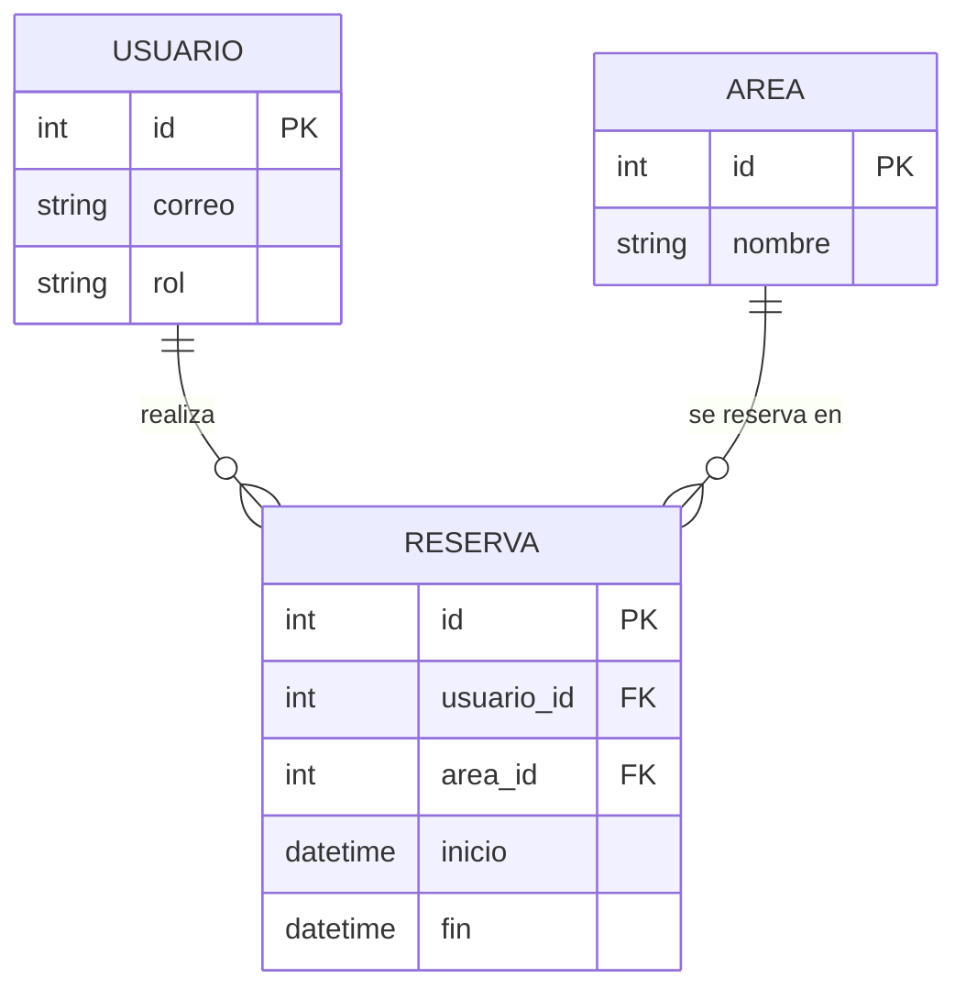

<!-- Reemplacen todo el texto entre corchetes y borren estos comentarios antes de entregar. -->

# Modelo de datos

## Diagrama entidad-relación

## Tablas

| Tabla | Descripción | Campos importantes |
|---|---|---|
| [usuario] | [...] | [...] |
