# Modelo de datos

La base de datos es PostgreSQL y el esquema se define en `prisma/schema.prisma`. Las tablas usan llaves primarias `uuid`, salvo los contadores y las tablas de unión. Los nombres de tabla y de columna son los de la base (`snake_case`).

## Diagrama entidad-relación

El diagrama muestra las 31 tablas con su llave primaria, sus llaves foráneas y los campos principales.

```mermaid
erDiagram
    towers ||--o{ units : "tiene"
    units |o--o{ users : "residentes"
    users |o--o{ units : "regenera codigo"
    users ||--o| profiles : "perfil"
    users ||--o{ refresh_tokens : "sesiones"
    users ||--o| directory_preferences : "privacidad"
    users ||--o{ notifications : "recibe"

    units ||--o{ incidents : "reporta"
    users ||--o{ incidents : "reportante"
    maintenance_staff |o--o{ incidents : "responsable"
    incidents ||--o{ incident_photos : "fotos"
    incidents ||--o{ incident_events : "historial"
    users ||--o{ incident_events : "autor"

    units ||--o{ visits : "recibe"
    users ||--o{ visits : "crea"
    users |o--o{ visits : "responde"
    users |o--o{ visits : "registra entrada"
    users |o--o{ visits : "registra salida"
    users |o--o{ visits : "cancela"

    units ||--o{ packages : "recibe"
    users ||--o{ packages : "recibe en porteria"
    users |o--o{ packages : "entrega"

    users |o--o{ common_areas : "actualiza"
    common_areas ||--o{ area_blocks : "bloqueos"
    users ||--o{ area_blocks : "crea"
    common_areas ||--o{ reservations : "se reserva"
    units ||--o{ reservations : "reserva"
    users ||--o{ reservations : "reserva"
    users |o--o{ reservations : "cancela"

    users ||--o{ assemblies : "convoca"
    assemblies ||--|{ assembly_topics : "temas"
    assembly_topics ||--|{ topic_options : "opciones"
    assemblies ||--o{ assembly_eligible_units : "habilita"
    units ||--o{ assembly_eligible_units : "habilitada"
    assembly_topics ||--o{ vote_participations : "participacion"
    units ||--o{ vote_participations : "vota"
    users ||--o{ vote_participations : "emite"
    assembly_topics ||--o{ ballots : "votos"
    topic_options ||--o{ ballots : "elegida"
    assembly_topics ||--o| topic_results : "resultado"

    users ||--o{ fee_generations : "genera"
    fee_generations ||--o{ fees : "crea"
    units ||--o{ fees : "debe"
    fees ||--o{ payments : "intentos"
    units ||--o{ payments : "paga"
    users ||--o{ payments : "pagador"

    users ||--o{ announcements : "publica"
    announcements ||--o{ announcement_towers : "audiencia"
    towers ||--o{ announcement_towers : "incluida"
    announcements ||--o{ announcement_recipients : "destinatarios"
    users ||--o{ announcement_recipients : "recibe"
    units ||--o{ announcement_recipients : "unidad"

    towers {
        uuid id PK
        string name UK
        string letter UK
    }
    units {
        uuid id PK
        uuid tower_id FK
        string number
        string code UK
        string registration_code UK
        uuid registration_code_updated_by_id FK
    }
    users {
        uuid id PK
        string email UK
        string password_hash
        enum role
        uuid unit_id FK
        boolean is_active
    }
    profiles {
        uuid id PK
        uuid user_id FK, UK
        string full_name
        string search_name
        string phone
    }
    refresh_tokens {
        uuid id PK
        string token_hash UK
        uuid user_id FK
        datetime expires_at
        datetime revoked_at
    }
    directory_preferences {
        uuid id PK
        uuid user_id FK, UK
        boolean visible
        boolean show_name
        boolean show_unit
        boolean show_phone
        boolean show_email
    }
    notifications {
        uuid id PK
        uuid user_id FK
        string title
        string message
        enum source_module
        string reference_type
        uuid reference_id
        datetime read_at
    }
    maintenance_staff {
        uuid id PK
        string name
        string specialty
        string phone
        boolean is_active
    }
    incidents {
        uuid id PK
        string number UK
        uuid unit_id FK
        uuid reporter_id FK
        uuid assignee_id FK
        string title
        enum location
        enum status
        enum priority
        datetime resolved_at
    }
    incident_photos {
        uuid id PK
        uuid incident_id FK
        string path
        string mime_type
        int size_bytes
    }
    incident_events {
        uuid id PK
        uuid incident_id FK
        uuid author_id FK
        enum type
        enum from_status
        enum to_status
        string note
    }
    incident_counters {
        int year PK
        int last
    }
    visits {
        uuid id PK
        string code UK
        enum origin
        uuid unit_id FK
        uuid created_by_id FK
        string visitor_name
        enum document_type
        string document_number
        date visit_date
        datetime valid_until
        enum status
        uuid responded_by_id FK
        uuid entry_by_id FK
        uuid exit_by_id FK
        uuid cancelled_by_id FK
    }
    packages {
        uuid id PK
        string code UK
        uuid unit_id FK
        string courier
        enum status
        uuid received_by_id FK
        uuid delivered_by_id FK
        string picked_up_by_name
    }
    package_counters {
        string day PK
        int last
    }
    common_areas {
        uuid id PK
        string name
        string name_key UK
        int capacity
        string open_time
        string close_time
        int slot_minutes
        boolean is_active
        uuid updated_by_id FK
    }
    area_blocks {
        uuid id PK
        uuid area_id FK
        date start_date
        date end_date
        string reason
        uuid created_by_id FK
    }
    reservations {
        uuid id PK
        string code UK
        uuid area_id FK
        uuid unit_id FK
        uuid user_id FK
        date date
        string start_time
        string end_time
        enum status
        string slot_key UK
        uuid cancelled_by_id FK
    }
    assemblies {
        uuid id PK
        string title
        datetime starts_at
        datetime ends_at
        enum status
        datetime opened_at
        datetime closed_at
        uuid created_by_id FK
    }
    assembly_topics {
        uuid id PK
        uuid assembly_id FK
        int order
        string question
    }
    topic_options {
        uuid id PK
        uuid topic_id FK
        string text
        int order
    }
    assembly_eligible_units {
        uuid assembly_id PK, FK
        uuid unit_id PK, FK
    }
    vote_participations {
        uuid id PK
        uuid topic_id FK
        uuid unit_id FK
        uuid user_id FK
        datetime voted_at
    }
    ballots {
        uuid id PK
        uuid topic_id FK
        uuid option_id FK
    }
    topic_results {
        uuid id PK
        uuid topic_id FK, UK
        int eligible_units
        int voted_units
        int total_votes
        json option_counts
        uuid winner_option_id
        datetime computed_at
    }
    fee_generations {
        uuid id PK
        string period
        decimal amount
        date due_date
        int created_count
        int skipped_count
        uuid created_by_id FK
    }
    fees {
        uuid id PK
        uuid unit_id FK
        uuid generation_id FK
        string period
        decimal amount
        date due_date
        enum status
        datetime paid_at
        datetime overdue_at
        datetime reminder_sent_at
    }
    payments {
        uuid id PK
        uuid fee_id FK
        uuid unit_id FK
        uuid payer_id FK
        decimal amount
        enum status
        string transaction_number UK
        string card_last4
        uuid idempotency_key UK
    }
    announcements {
        uuid id PK
        string title
        string body
        enum category
        enum audience
        datetime published_at
        date expires_on
        uuid created_by_id FK
    }
    announcement_towers {
        uuid announcement_id PK, FK
        uuid tower_id PK, FK
    }
    announcement_recipients {
        uuid id PK
        uuid announcement_id FK
        uuid user_id FK
        uuid unit_id FK
        datetime read_at
    }
```

## Tablas

| Tabla | Descripción | Campos importantes |
|---|---|---|
| towers | Torres del condominio (H39). | `name` y `letter`, únicos |
| units | Unidades (apartamentos) de cada torre (H39). | `code` (por ejemplo A-101), único; `tower_id` y `number`, únicos juntos; `registration_code` para el registro de residentes (H38, H2) |
| users | Cuentas del sistema, una por persona, con su rol (H38). | `email`, único; `role` (RESIDENTE, ADMINISTRADOR o SEGURIDAD); `unit_id`, solo en residentes; `is_active` |
| profiles | Datos personales del usuario, uno a uno con `users` (H38). | `full_name`; `search_name` en minúsculas y sin tildes para las búsquedas; `phone` |
| refresh_tokens | Refresh tokens emitidos al iniciar sesión. Se guarda solo su hash (H38). | `token_hash`, único; `expires_at`; `revoked_at` al rotarlo o al cerrar sesión |
| directory_preferences | Qué datos comparte cada residente en el directorio (H28). | `visible`; `show_name`, `show_unit`, `show_phone` y `show_email` |
| notifications | Avisos por usuario. Solo los crea el servicio de envío (H30); la bandeja los muestra (H31). | `source_module`; `reference_type` y `reference_id` para abrir el registro de origen; `read_at` |
| maintenance_staff | Responsables de mantenimiento. Catálogo sin acceso al sistema, cargado por el seed (H12, H39). | `name`, `specialty`, `phone`, `is_active` |
| incidents | Incidencias reportadas por residentes (H10). No se borran. | `number` (INC-AAAA-NNNNN), único; `status`; `priority`; `assignee_id`; `resolved_at`; `search_key` |
| incident_photos | Fotografías de una incidencia, de 1 a 3 (H10). | `path`, `mime_type`, `size_bytes` |
| incident_events | Historial de una incidencia: creación, cambios de estado, de prioridad y de responsable (H10 a H13). No se modifican ni se borran. | `type`; `from_status` y `to_status`; `from_value` y `to_value`; `note`; `author_id` |
| incident_counters | Último consecutivo por año del número de incidencia (H10). | `year`, `last` |
| visits | Bitácora de acceso: visitas preautorizadas y solicitudes de portería (H14 a H18). No se borran. | `code` de 6 caracteres, único; `origin`; `status`; `visit_date`; `valid_from` y `valid_until`; quién respondió, registró la entrada, la salida o canceló |
| packages | Paquetes que llegan a portería para una unidad (H19 a H21). No se borran. | `code` (PQ-AAAAMMDD-NNNN), único; `status`; quién lo recibió y quién lo entregó; datos de quien lo retiró |
| package_counters | Último consecutivo por día del código de paquete (H19). | `day`, `last` |
| common_areas | Áreas comunes reservables (H9). No se borran: se deshabilitan con `is_active`. | `name_key`, único; `capacity`; `open_time` y `close_time`; `slot_minutes` |
| area_blocks | Bloqueos de un área por mantenimiento (H9). | `start_date` y `end_date`; `reason` |
| reservations | Reservas de una franja de un área (H7, H8, H9). | `code`, único; `date`, `start_time` y `end_time`; `status` (CONFIRMADA, CANCELADA o CANCELADA_ADMIN); `slot_key`, único mientras la reserva está confirmada |
| assemblies | Asambleas y su votación (H22). Una tarea programada cambia su estado. | `status` (PROGRAMADA, ABIERTA o CERRADA); `starts_at` y `ends_at`; `opened_at` y `closed_at` |
| assembly_topics | Temas de la agenda, de 1 a 10 por asamblea (H22). | `order` y `question`; `assembly_id` y `order`, únicos juntos |
| topic_options | Opciones de voto de un tema, de 2 a 6 (H22). | `text` y `order` |
| assembly_eligible_units | Unidades habilitadas para votar. Se crean al abrir la asamblea y no cambian (H22). | `assembly_id` y `unit_id` como llave |
| vote_participations | Registro de que una unidad votó un tema, sin la opción elegida (H23). | `topic_id` y `unit_id`, únicos juntos: un voto por unidad por tema |
| ballots | Voto emitido: solo tema y opción, sin unidad, usuario ni fecha, para que el voto sea secreto (H23). | `topic_id`, `option_id` |
| topic_results | Resultado de un tema, calculado al cerrar la asamblea. No se modifica (H24). | `eligible_units`, `voted_units`, `total_votes`; `option_counts`; `winner_option_id` |
| fee_generations | Cada generación mensual de cuotas (H3). | `period` (AAAA-MM); `amount`; `due_date`; `created_count` y `skipped_count` |
| fees | Cuotas de mantenimiento por unidad y periodo (H3 a H5). | `unit_id` y `period`, únicos juntos; `status` (PENDIENTE, PAGADO o MOROSO); `due_date`; `overdue_at`; `reminder_sent_at` |
| payments | Intentos de pago de una cuota con la pasarela simulada, aprobados o rechazados (H1). | `status`; `transaction_number`, único; `card_last4`; `idempotency_key`, único |
| announcements | Comunicados publicados por la administración (H25). | `category`; `audience` (TODOS o TORRES); `published_at`; `expires_on` |
| announcement_towers | Torres a las que va un comunicado cuando la audiencia es por torres (H25). | `announcement_id` y `tower_id` como llave |
| announcement_recipients | Un registro por residente que recibe el comunicado, creado al publicar (H25). | `read_at`, la primera lectura (H26, H27); `announcement_id` y `user_id`, únicos juntos |
